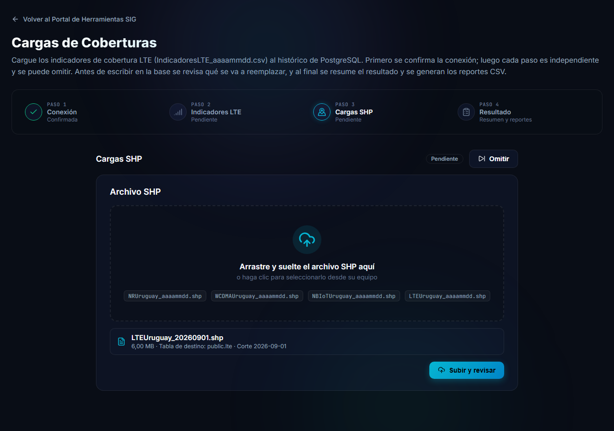
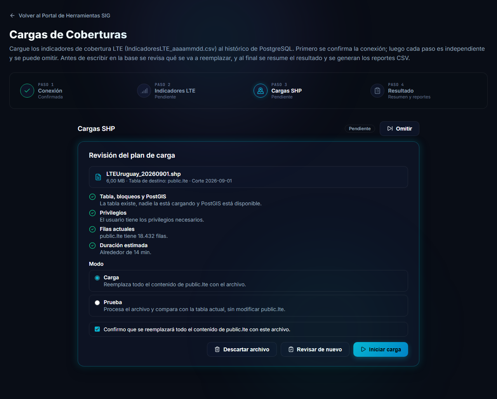
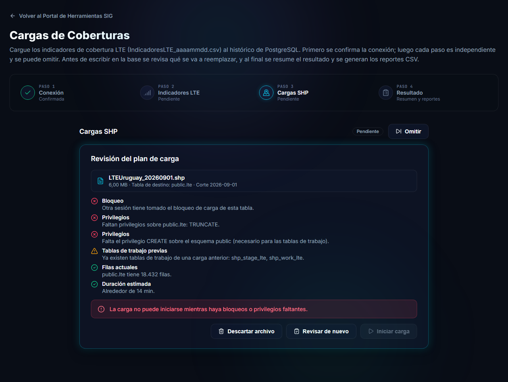
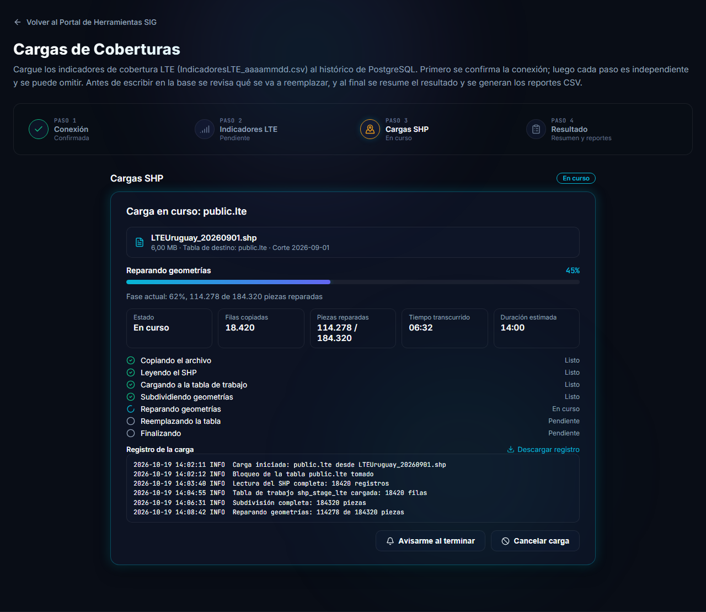
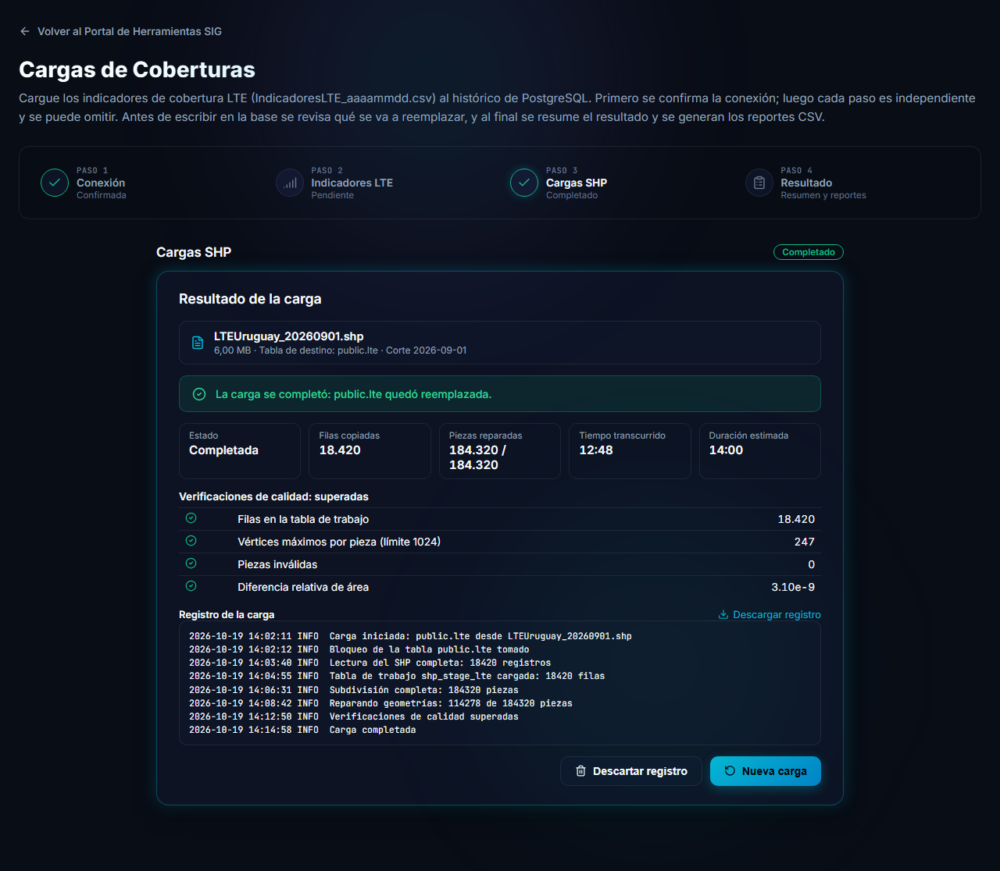
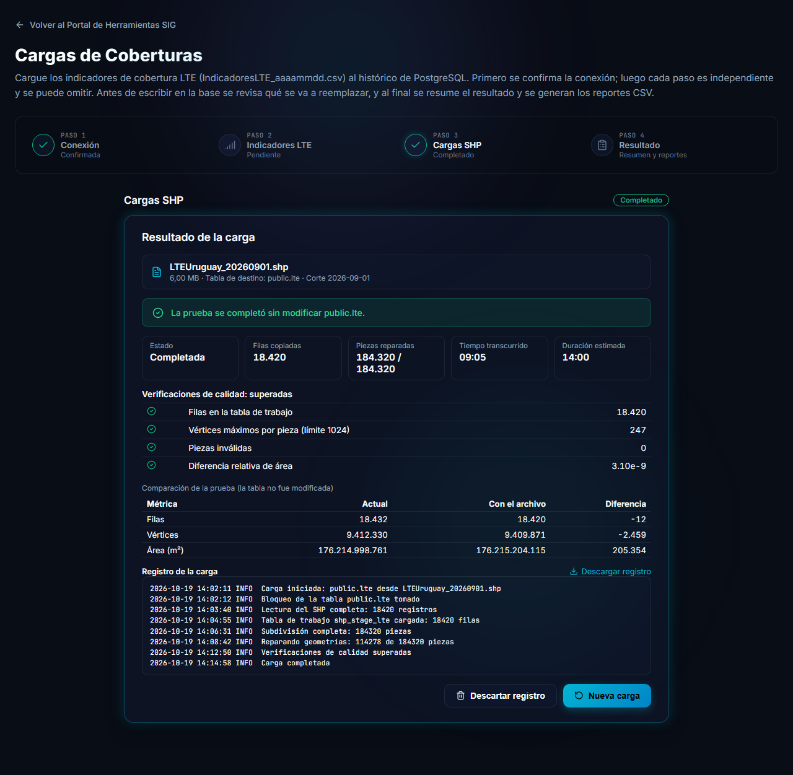
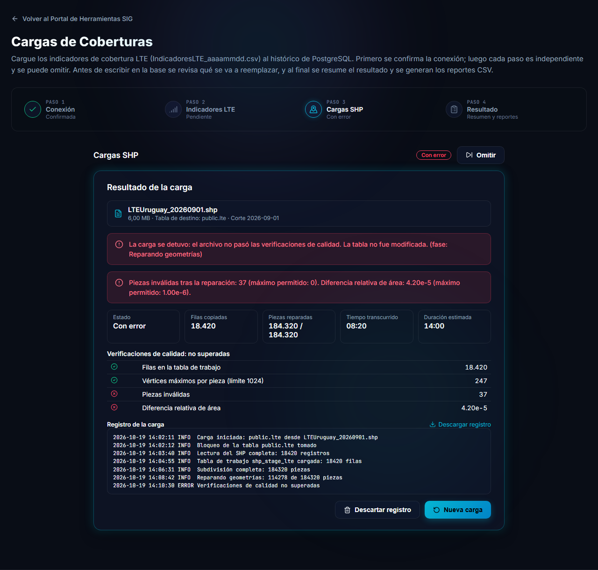

# Etapa Cargas SHP (geometrías)

Esta etapa carga un archivo de geometrías (`.shp`) de cobertura en su tabla de destino. A diferencia de los indicadores, **reemplaza todo el contenido de la tabla**: la carga vacía la tabla y la rellena con el archivo, y lo hace en una sola operación que, si algo falla, **deja los datos anteriores intactos**.

Los archivos pueden ser muy grandes (hasta 4 GB) y la carga puede tardar varios minutos. Por eso la herramienta trabaja en segundo plano, muestra el avance y permite cerrar la pantalla sin perder la carga.

> [!TIP]
> La primera vez que cargue un archivo, use el modo **Prueba**: procesa todo y lo compara con la tabla actual, pero **no modifica** la tabla.

## Elegir el archivo

El nombre del archivo determina a qué tabla va y de qué fecha es:

| Prefijo del archivo | Tabla de destino |
|---|---|
| `NRUruguay_aaaammdd.shp` | `public.cobertura5g` |
| `WCDMAUruguay_aaaammdd.shp` | `public.wcdma` |
| `NBIoTUruguay_aaaammdd.shp` | `public.nbiot` |
| `LTEUruguay_aaaammdd.shp` | `public.lte` |

`aaaammdd` es la fecha del corte y debe ser una fecha real. Si el nombre no coincide con ninguno de los cuatro, el archivo no se acepta.

Arrastre el archivo a la zona punteada o haga clic para elegirlo. La herramienta muestra el tamaño, la **tabla de destino** y el **corte**. Presione **Subir y revisar**: el archivo se sube al servidor con una barra de avance (puede cancelarla) y, al terminar, se pide automáticamente el plan de carga.

> [!NOTE]
> La herramienta asume que las geometrías del archivo están en el sistema de coordenadas **EPSG:32721** y no las reproyecta. Si su archivo está en otro sistema, conviértalo antes de cargarlo.

## Revisar el plan

La revisión hace verificaciones **sin modificar nada** y las muestra en una lista:

| Verificación | Qué comprueba |
|---|---|
| **Tabla, bloqueos y PostGIS** | La tabla existe, nadie más la está cargando y PostGIS está disponible. |
| **Privilegios** | El usuario tiene los permisos necesarios sobre la tabla y sobre el esquema `public`. |
| **Filas actuales** | Cuántas filas tiene hoy la tabla de destino. |
| **Duración estimada** | Un cálculo aproximado de cuánto tardará. |

### Elegir el modo

- **Carga** reemplaza todo el contenido de la tabla de destino con el archivo. Para iniciarla debe marcar la casilla *Confirmo que se reemplazará todo el contenido de … con este archivo*.
- **Prueba** procesa el archivo y compara el resultado con la tabla actual, **sin modificarla**. No requiere confirmación.

Los botones **Descartar archivo** (cancela y elimina el archivo subido) y **Revisar de nuevo** (repite las verificaciones) están siempre disponibles. **Iniciar carga** se habilita cuando todo está en orden.

### Cuando hay un bloqueo

Si alguna verificación falla, se marca en rojo y **no se puede iniciar**:

- **Bloqueo:** otra sesión tiene tomada la carga de esa tabla. Espere a que termine y use **Revisar de nuevo**.
- **Privilegios:** faltan permisos (por ejemplo `DELETE` sobre la tabla, o `CREATE` sobre el esquema `public`). Pídaselos al administrador de la base de datos: vea [Preguntas frecuentes](preguntas-frecuentes.md).
- **Tablas de trabajo previas** (en naranja): quedaron tablas auxiliares de una carga anterior. Es solo un aviso y no impide cargar.

## Seguir la carga

Al iniciar, la pantalla muestra el avance en vivo.

- La **barra** indica el avance total y la **fase actual** con su detalle (por ejemplo, cuántas piezas se repararon).
- Se ven el **estado**, las **filas copiadas**, el **tiempo transcurrido** y la **duración estimada**.
- La lista de fases va de *Copiando el archivo* a *Finalizando*. La fase **Reemplazando la tabla** es el único momento en que la tabla de destino cambia, y ocurre al final de todo.
- El **registro de la carga** muestra lo que va pasando, y *Descargar registro* guarda las últimas líneas.
- **Avisarme al terminar** pide permiso al navegador para mostrar una notificación cuando termine.
- **Cancelar carga** detiene el proceso. Si se cancela antes de reemplazar la tabla, la tabla queda como estaba.

### Puede cerrar la pantalla

La carga corre en el servidor, no en su navegador. Si navega a otra página o cierra la pestaña, **la carga sigue**. Mientras haya una en curso, un indicador fijo en una esquina de cualquier página de la aplicación muestra el avance, y el título de la pestaña lleva el porcentaje.

Al volver a la herramienta y confirmar la conexión, la etapa retoma la carga en curso o muestra la que está lista para revisar.

> [!WARNING]
> Solo puede haber **una carga por tabla** a la vez. Mientras una está en curso, otra para la misma tabla queda bloqueada.

## Resultado

### Carga completada

Al terminar se muestra el resultado (*La carga se completó: la tabla quedó reemplazada*), las estadísticas, el registro y las **verificaciones de calidad**, que la herramienta aplica a las geometrías **antes** de tocar la tabla:

| Verificación | Qué mide |
|---|---|
| **Filas en la tabla de trabajo** | Que se leyeron todos los registros del archivo. |
| **Vértices máximos por pieza** | Que ninguna pieza supere el límite (1024 vértices). |
| **Piezas inválidas** | Que, tras la reparación, no quede ninguna geometría inválida. |
| **Diferencia relativa de área** | Que el área no haya cambiado de forma apreciable al procesar las geometrías. |

Si alguna no se supera, la carga **se detiene sin modificar la tabla**.

### Resultado de una prueba

El modo Prueba termina con el aviso *La prueba se completó sin modificar la tabla* y una **comparación** entre la tabla actual y el archivo: filas, vértices y área, con la diferencia entre ambos. Úsela para confirmar que el archivo es el esperado antes de hacer la carga real.

### Si la carga falla

Cuando algo falla, la pantalla explica en qué fase se detuvo y por qué, y marca en rojo las verificaciones que no se superaron. En ese caso **la tabla de destino no se modifica**. Las causas más comunes están en [Preguntas frecuentes](preguntas-frecuentes.md).

Desde la pantalla de resultado puede **Descartar registro** (elimina el registro de esa carga) o iniciar una **Nueva carga**. Los registros de cargas terminadas se eliminan solos después de unos días.
