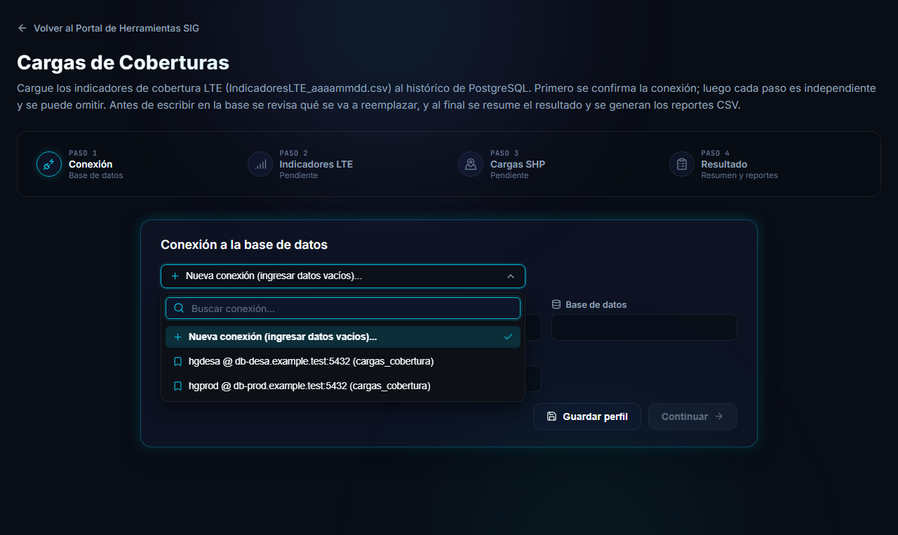
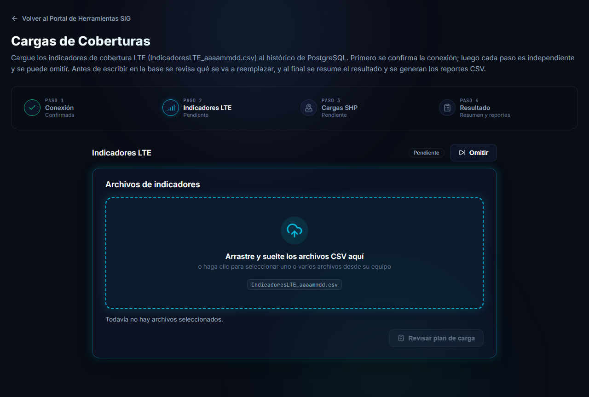

# Conectar a la base de datos y estados de las etapas

El primer paso de la herramienta es la **Conexión**: se indica a qué base de datos se va a cargar y recién después se habilitan las etapas.

## Completar la conexión

| Campo | Qué ingresar |
|---|---|
| **Servidor** | Nombre o dirección del servidor PostgreSQL. |
| **Puerto** | Por defecto `5432`. |
| **Base de datos** | La base a la que se va a cargar. |
| **Usuario** | Un usuario con permisos de escritura sobre las tablas que va a cargar. |
| **Contraseña** | La contraseña del usuario. |

> [!NOTE]
> La contraseña **nunca se guarda**: solo se mantiene en memoria mientras la página está abierta, y se envía únicamente al servidor de la aplicación para ejecutar las operaciones. Si recarga la página tendrá que ingresarla de nuevo.

Presione **Continuar** para confirmar la conexión.

### Perfiles guardados

Con **Guardar perfil** puede guardar los datos de conexión (sin contraseña) **en este equipo**, por ejemplo uno para la base de desarrollo y otro para la de producción. La lista de perfiles incluye un buscador para encontrarlos rápido.

- La búsqueda no distingue mayúsculas ni tildes.
- **Nueva conexión (ingresar datos vacíos)...** siempre está disponible y deja el formulario en blanco.

Vea también cómo funcionan los perfiles en las demás herramientas: [Conectar las bases de datos](/wiki/db-db-sync/conexion).

> [!WARNING]
> Verifique **a qué base se conecta** antes de continuar, sobre todo si tiene perfiles de desarrollo y de producción. Las cargas modifican datos de la base elegida.

## Etapas disponibles

Con la conexión confirmada, el paso 1 muestra *Confirmada* y se habilitan las etapas **Indicadores LTE** y **Cargas SHP**.

- Las etapas son **independientes**: puede hacerlas en cualquier orden.
- Una etapa que no necesita se puede **omitir** con el botón **Omitir**, y retomarla después, siempre que no esté trabajando ni completada.
- Las etapas ya iniciadas siguen ahí cuando pasa de una a otra: no pierde lo que había avanzado.

### Estados de una etapa

| Estado | Significa |
|---|---|
| **Pendiente** | Todavía no se hizo nada, o hubo un error de validación que se muestra dentro de la etapa. |
| **Omitido** | La etapa se omitió. Se puede retomar. |
| **En curso** | La etapa está trabajando (subiendo, revisando o cargando). |
| **Completado** | La etapa terminó. |
| **Con error** | La carga en segundo plano falló. Se explica el motivo dentro de la etapa. |

## Cambiar la conexión

- Mientras una etapa está **en curso** no se puede editar la conexión: el paso 1 no se puede abrir.
- Si confirma una conexión **distinta**, las revisiones previas (planes) que ya había hecho se descartan y hay que revisar de nuevo, porque dependían de la base anterior. Una etapa ya completada conserva su resultado como historial.

## Siguiente

Continúe con la [etapa Indicadores LTE](indicadores-lte.md) o con la [etapa Cargas SHP](cargas-geometrias.md).
