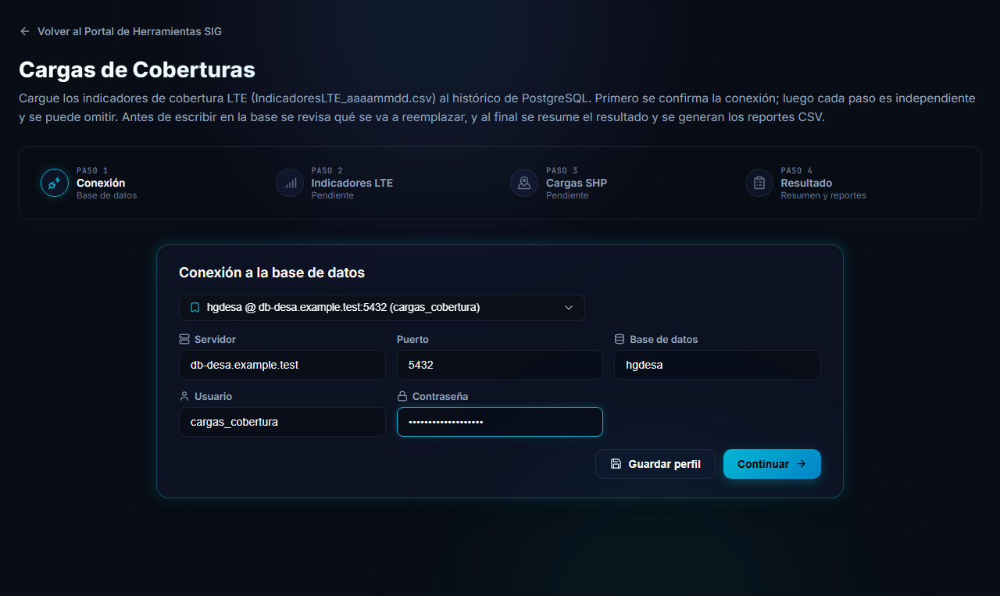

# Cargas de Coberturas

Esta herramienta carga a PostgreSQL los datos que se actualizan cada mes y genera los reportes que se derivan de ellos. Trabaja siempre contra una base de datos (por ejemplo la de desarrollo o la de producción) y **antes de escribir cualquier dato le muestra qué va a cambiar**.

Se abre desde el portal, en la tarjeta **Cargas de Coberturas**.

## Tipos de carga

Al empezar se elige qué se va a cargar. Cada tipo tiene sus propias etapas:

| Tipo de carga | Etapas |
|---|---|
| **Cobertura (3G, LTE, 5G, NBIOT)** | Indicadores LTE y Cargas SHP. |
| **FTTH** | Capas SIGRA y Avance FTTH. |

## Qué se puede hacer

Cada etapa carga un tipo de dato distinto, y puede hacer una, las dos o ninguna:

| Tipo de carga | Etapa | Qué carga | Cómo actualiza |
|---|---|---|---|
| Cobertura | **Indicadores LTE** | Los archivos mensuales `IndicadoresLTE_aaaammdd.csv` con la cobertura LTE por localidad. | Reemplaza el **corte** (la fecha) que trae cada archivo en el histórico, sin duplicar filas. |
| Cobertura | **Cargas SHP** | Un archivo de geometrías (`.shp`) de cobertura 5G, 3G, NB-IoT o LTE. | Reemplaza **todo el contenido** de la tabla de destino, en una sola operación que se revierte si algo falla. |
| FTTH | **Capas SIGRA** | Las 18 capas de SIGRA que usa el Avance, entre ellas las zonas FTTH y los límites de centrales FTTH. | Reemplaza la tabla de cada capa, solo si la descarga pasa la validación del 97 %. Es obligatoria y no se puede omitir. |
| FTTH | **Avance FTTH** | Dos planillas CSV (`SituacionFTTH_INT_` y `SituacionFTTH_UDPEM_`, con fecha). | Reconstruye la tabla de Avance cruzándola con las zonas de SIGRA, y copia el Avance anterior al historial. |

Al final, el paso **Resultado** resume cómo terminó cada etapa. Para cobertura permite **descargar los tres reportes CSV** de cobertura LTE. Para FTTH permite descargar los **cinco reportes del Avance**, individualmente o en un ZIP.

## Cómo funciona

1. **Tipo de carga y conexión.** Se elige el tipo de carga (Cobertura o FTTH) y se confirma una sola vez la conexión a la base de datos. Recién entonces se habilitan las etapas del tipo elegido.
2. **Etapas.** En Cobertura se trabaja en cualquier orden. En FTTH, primero se completa **Capas SIGRA**: la etapa **Avance FTTH** queda bloqueada hasta entonces. Cada etapa tiene su propia revisión previa: se ve qué se va a reemplazar y recién después se confirma. Una etapa que no es obligatoria se puede **omitir**.
3. **Resultado.** Muestra el estado de cada etapa y los reportes.

> [!TIP]
> En todas las etapas la herramienta **revisa antes de escribir**. Las etapas de geometrías y de capas SIGRA ofrecen un modo **Prueba** (o *Probar sin guardar*), que procesa los datos y los compara con la tabla actual sin modificarla. Úselo la primera vez que cargue un archivo.

## Qué necesita antes de empezar

- Los datos de conexión de la base: servidor, puerto, base de datos, usuario y contraseña. La contraseña no se guarda.
- Los archivos con el **nombre correcto**: `IndicadoresLTE_aaaammdd.csv` para los indicadores, `<Prefijo>_aaaammdd.shp` para las geometrías, y `SituacionFTTH_INT_ddmmaaaa.csv` y `SituacionFTTH_UDPEM_ddmmaaaa.csv` para el Avance FTTH.
- Que su usuario tenga **permisos de escritura** sobre las tablas que va a cargar (el detalle está en [Preguntas frecuentes](preguntas-frecuentes.md), sección *Permisos*). Si falta alguno, la propia pantalla de revisión lo informa y no deja continuar.
- Para FTTH, que el servidor pueda consultar SIGRA al cargar sus capas.

## Siguientes páginas

1. [Conectar a la base de datos y estados de las etapas](conexion.md)
2. [Etapa Indicadores LTE](indicadores-lte.md)
3. [Etapa Cargas SHP (geometrías)](cargas-geometrias.md)
4. [Etapa Capas SIGRA](capas-sigra.md)
5. [Etapa Avance FTTH](avance-ftth.md)
6. [Resultado y reportes](resultado-y-reportes.md)
7. [Preguntas frecuentes y problemas comunes](preguntas-frecuentes.md)
