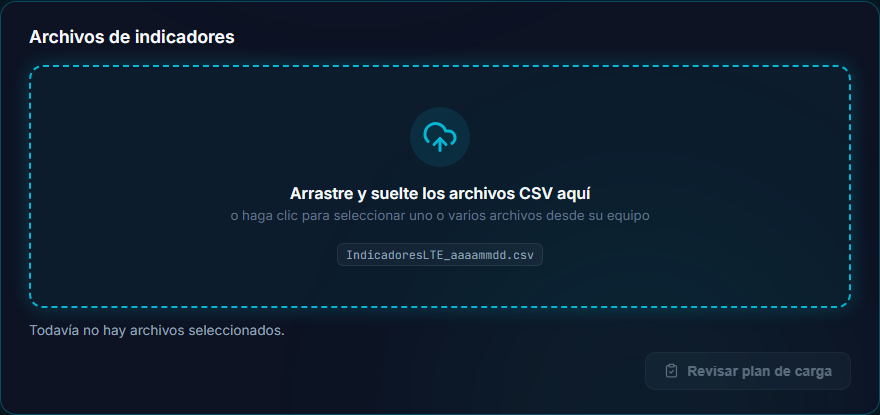
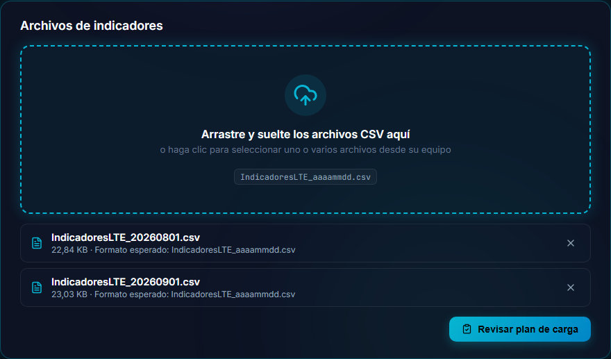
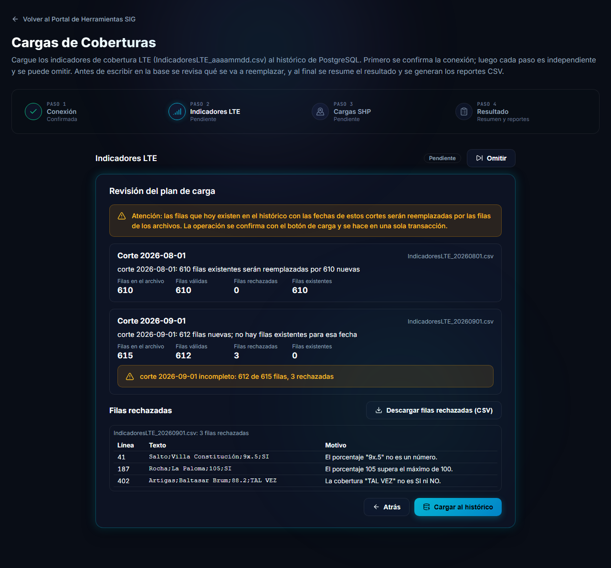
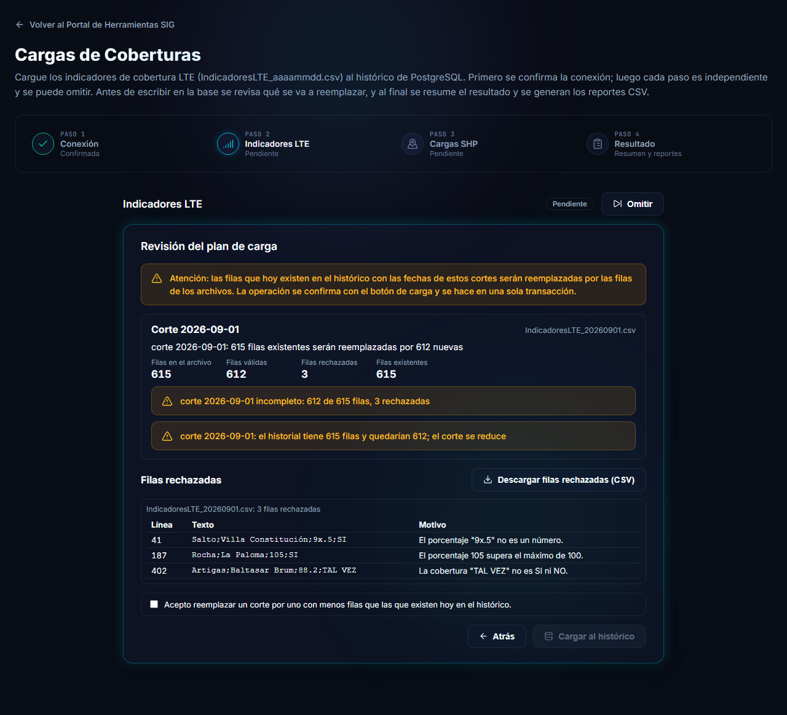
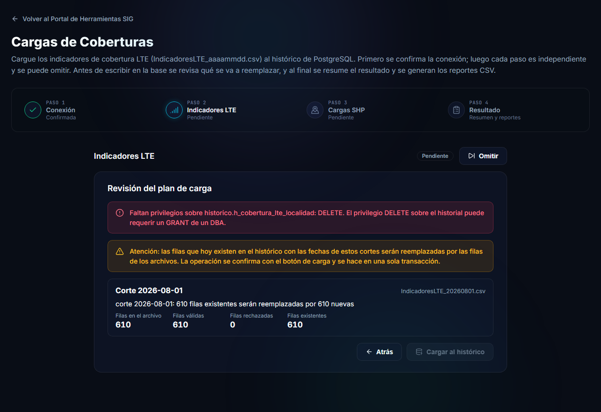
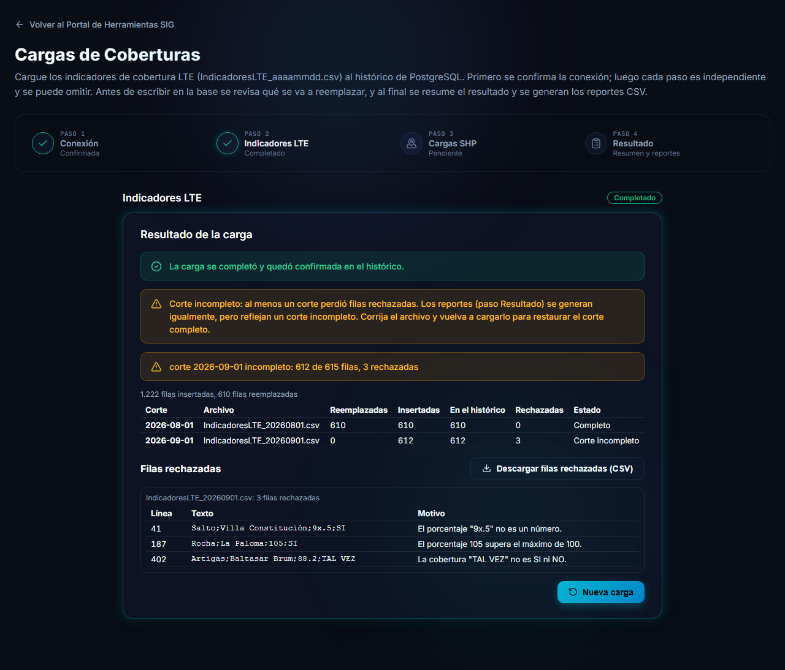

# Etapa Indicadores LTE

Esta etapa carga al histórico de PostgreSQL los archivos mensuales de cobertura LTE por localidad. Cada archivo trae un **corte** (una fecha) y la carga **reemplaza** ese corte en el histórico: si vuelve a cargar el mismo archivo, o una versión corregida, las filas no se duplican.

## Preparar los archivos

### Nombre del archivo

El nombre debe ser exactamente:

```
IndicadoresLTE_aaaammdd.csv
```

- `IndicadoresLTE_` y la extensión `.csv` en minúscula: se distinguen mayúsculas y minúsculas.
- `aaaammdd` es la **fecha del corte** y debe ser una fecha real del calendario (por ejemplo `20260901`).
- Si el nombre no cumple, el archivo se rechaza antes de tocar la base de datos.

### Contenido

- Texto separado por **punto y coma** (`;`), codificado en **ISO-8859-1** (latin1), que es el formato habitual de estos archivos.
- La **primera línea** (encabezados) se ignora.
- Cuatro columnas, en este orden: `Departamento;Localidad;%;Cobertura`.
- Los valores se recortan por ambos lados. Un valor `-` se toma como vacío.
- `Cobertura` debe ser `SI` o `NO` (da igual si viene en mayúscula o minúscula; se guarda en mayúscula).
- Las líneas en blanco se omiten.

Puede cargar **varios archivos a la vez** (hasta 24, de hasta 10 MB cada uno), siempre que cada uno tenga una fecha distinta. Cada fecha es un corte independiente.

## Elegir los archivos



Arrastre los archivos a la zona punteada o haga clic para elegirlos desde su equipo. Se listan con su tamaño y se pueden quitar con la **X**.



Presione **Revisar plan de carga**. En este momento **no se escribe nada** en la base de datos: la herramienta solo lee y calcula qué pasaría.

## Revisar el plan



La revisión muestra, por cada corte:

| Dato | Significa |
|---|---|
| **Filas en el archivo** | Cuántas filas de datos tiene el archivo. |
| **Filas válidas** | Las que se van a cargar. |
| **Filas rechazadas** | Las que tienen algún problema y no se cargan (ver más abajo). |
| **Filas existentes** | Cuántas filas tiene hoy el histórico para esa fecha y **serán reemplazadas**. |

Un mensaje por corte lo resume, por ejemplo: *corte 2026-08-01: 610 filas existentes serán reemplazadas por 610 nuevas*.

> [!WARNING]
> La carga **reemplaza todas las filas** del histórico que tengan la fecha de cada corte. Verifique que el archivo corresponde a la fecha correcta: la herramienta confía en el contenido del archivo.

### Filas rechazadas

Los problemas **por fila no impiden la carga**: las filas válidas se guardan y las malas se listan con el archivo, la línea, el texto original y el motivo. Una fila se rechaza cuando:

- no tiene exactamente 4 columnas;
- `Departamento` o `Localidad` están vacíos, o son demasiado largos (más de 15 y 40 caracteres, respectivamente);
- `%` no es un número positivo, o es mayor que 100;
- `Cobertura` no es `SI` ni `NO`;
- contiene un carácter nulo, o una comilla que se abre y no se cierra;
- el par (`Departamento`, `Localidad`) está repetido dentro del archivo (se conserva la primera aparición).

Con **Descargar filas rechazadas (CSV)** obtiene la lista para corregir el archivo de origen.

### Corte incompleto

Un corte al que se le rechazaron filas se marca como **incompleto**, por ejemplo: *corte 2026-09-01 incompleto: 612 de 615 filas, 3 rechazadas*. Se puede cargar igual, pero los reportes lo señalan. Corrija el archivo y vuelva a cargarlo para restaurar el corte completo.

### Archivo rechazado completo

Algunos problemas rechazan **el archivo entero** (no se guarda nada de él): nombre o fecha inválidos, archivo ilegible o de más de 10 MB, sin filas de datos, sin ninguna fila válida, o dos archivos con la misma fecha en la misma carga.

### Si el corte tendría menos filas que hoy

Si las filas válidas de un corte son **menos** que las que el histórico tiene hoy para esa fecha, la herramienta lo advierte y pide una confirmación adicional.



Para continuar debe marcar la casilla *Acepto reemplazar un corte por uno con menos filas que las que existen hoy en el histórico*. Esto protege un corte completo de ser reemplazado por un archivo parcial.

### Permisos que faltan

Si el usuario no tiene los permisos necesarios, la revisión lo informa y **no permite cargar**.



El más común es `DELETE` sobre el histórico, que el administrador de la base de datos puede otorgar. Vea [Preguntas frecuentes](preguntas-frecuentes.md).

## Cargar

Cuando todo es correcto, presione **Cargar al histórico**. Toda la carga se hace **en una sola transacción**: si algo falla, no se cambia nada y las filas anteriores quedan como estaban.

> [!NOTE]
> Si otra persona está cargando al mismo tiempo, la segunda carga espera unos segundos y, si no se libera, avisa *Otra carga está en curso, intente de nuevo en unos segundos*. Si una operación tarda demasiado se cancela con el aviso *La operación excedió el tiempo máximo*, y no se cambia nada.

## Resultado de la carga



Al terminar se muestra, por cada corte, cuántas filas se **reemplazaron**, cuántas se **insertaron**, cuántas quedaron **en el histórico**, cuántas se **rechazaron** y si el corte quedó *Completo* o *Incompleto*. La etapa pasa a **Completado**.

Desde aquí puede descargar de nuevo las filas rechazadas o empezar una **Nueva carga**. Los [reportes](resultado-y-reportes.md) se generan en el paso **Resultado**.
