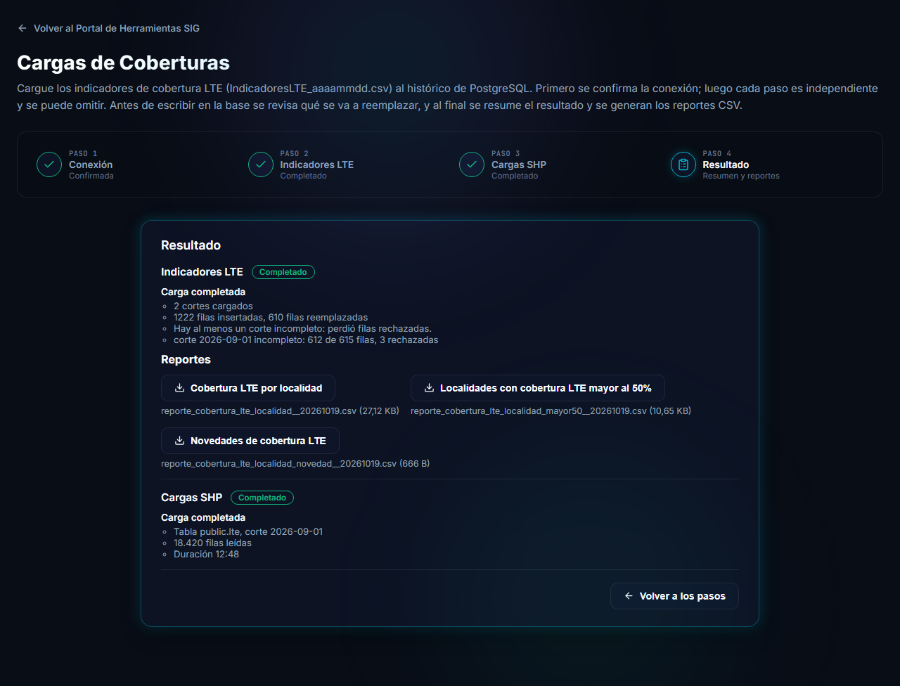

# Resultado y reportes

El último paso, **Resultado**, resume cómo terminó cada etapa y permite descargar los tres reportes CSV de cobertura LTE.



## Estado de las etapas

Por cada etapa se muestra su estado (*Completado*, *Omitido*, *Pendiente*, *Con error*), un titular y unas líneas con los datos principales: por ejemplo, cuántos cortes se cargaron y cuántas filas se insertaron o reemplazaron, o la tabla y la fecha de una carga de geometrías. Si algún corte quedó incompleto, se advierte aquí.

El botón **Volver a los pasos** regresa a las etapas.

## Reportes

Los reportes se generan **leyendo el histórico**, sin modificar nada, y se descargan como archivos CSV. Solo requieren que la conexión esté confirmada: están disponibles en cualquier momento, **aunque la etapa Indicadores LTE se haya omitido** o no se haya cargado nada en esta sesión.

| Botón | Contenido |
|---|---|
| **Cobertura LTE por localidad** | Todas las localidades del **último corte** del histórico, con su porcentaje de cobertura. |
| **Localidades con cobertura LTE mayor al 50%** | Las localidades del último corte con cobertura mayor al 50 % y cobertura `SI`. |
| **Novedades de cobertura LTE** | Las localidades que alcanzaron el 50 % de cobertura con `SI` en los últimos 3 meses y antes no lo habían alcanzado. |

Debajo de cada botón aparece el nombre del archivo descargado y su tamaño.

> [!NOTE]
> El **último corte** es la fecha más reciente que existe en el histórico, no necesariamente la que se cargó en esta sesión.

### Nombre de los archivos

```
reporte_cobertura_lte_localidad__aaaammdd.csv
reporte_cobertura_lte_localidad_mayor50__aaaammdd.csv
reporte_cobertura_lte_localidad_novedad__aaaammdd.csv
```

El `aaaammdd` es **el día en que se genera el reporte**, no la fecha del corte. El doble guion bajo antes de la fecha es intencional.

### Formato

- Columnas separadas por **punto y coma** (`;`), con una fila de encabezados.
- Codificación **ISO-8859-1** (latin1), para que los acentos se vean bien al abrirlos en Excel en español.
- Los porcentajes se muestran sin ceros finales (`91.30` se escribe `91.3`, `100.00` se escribe `100`).
- La fecha de novedad tiene el formato `dd-mm-aaaa`.

> [!TIP]
> Un reporte **sin filas** se descarga como un archivo **vacío** (sin siquiera encabezados). En el reporte de novedades significa que no hay novedades.
