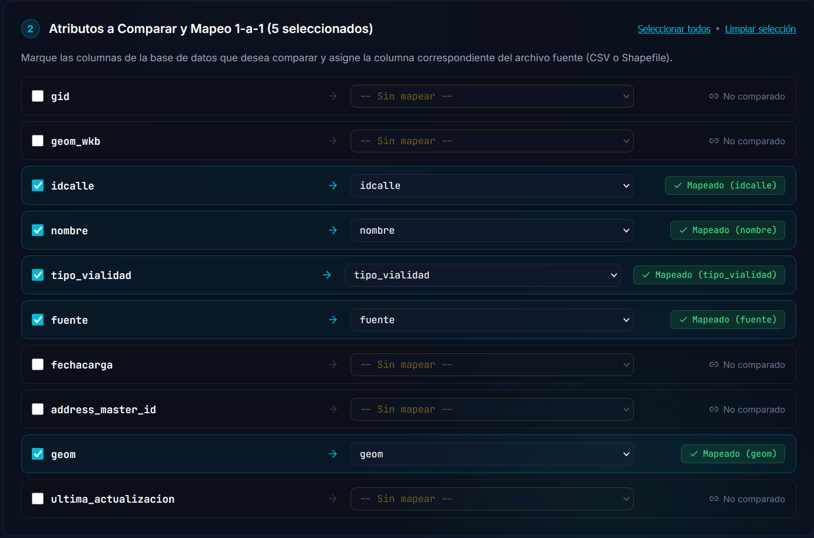
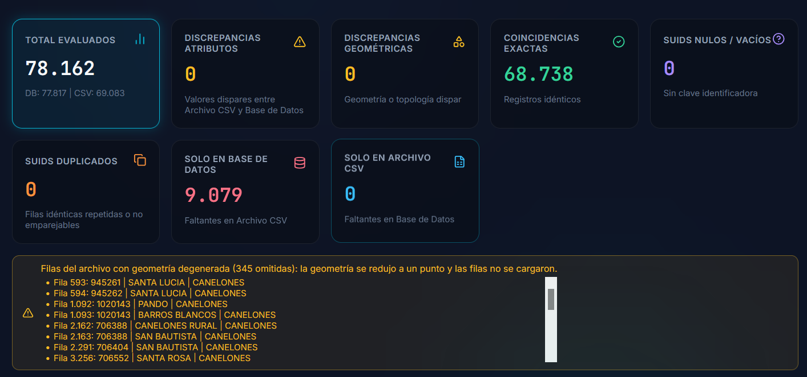
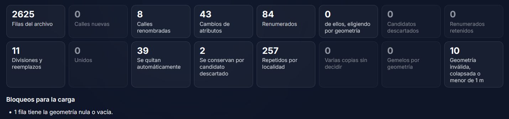
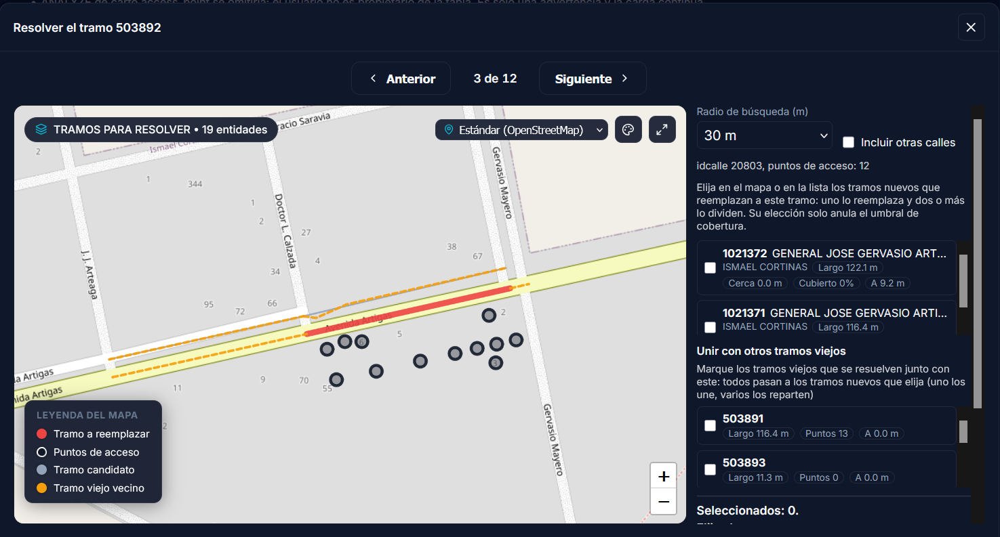
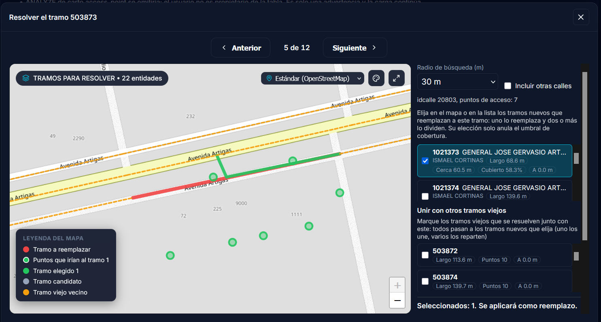
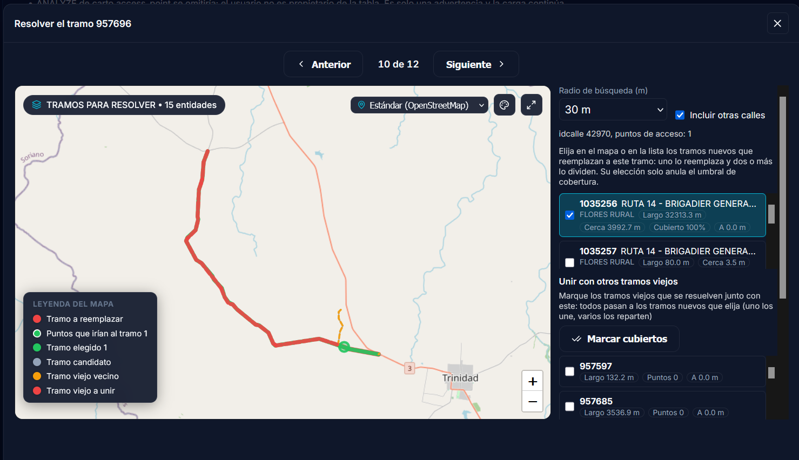
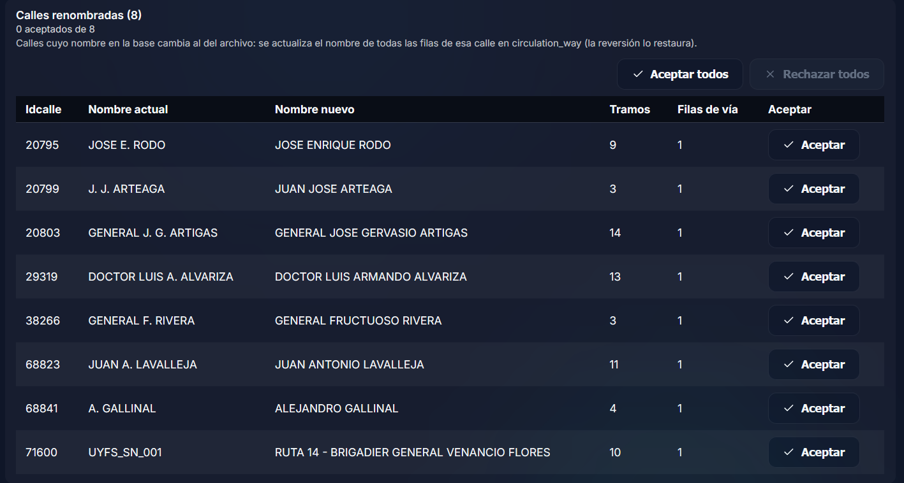
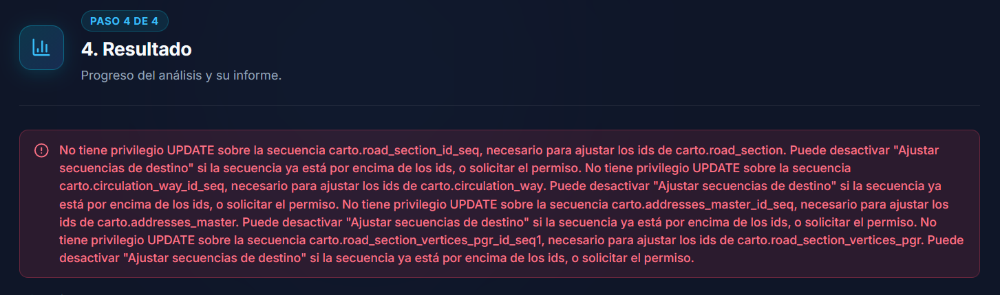

# Carga de ejes de calles

Este trabajo lleva los **ejes de vías de circulación** que publica IDEUy a las tablas de carto: tramos de calle (`carto.road_section`), vías de circulación (`carto.circulation_way`), direcciones maestras, vértices de ruteo y los puntos de acceso que cuelgan de los tramos. Compara el archivo con lo que hay en carto, resuelve solo lo que las reglas permiten decidir y **le pide a usted que decida el resto**. Tiene su propia tarjeta en la lista de trabajos y su propio asistente.

## Reglas que nunca se rompen

- **No se borra ningún punto de acceso** (`carto.access_point`). Solo se actualiza a qué tramo y a qué calle pertenece.
- **Un tramo con puntos de acceso nunca se quita**, aunque el archivo ya no lo traiga.
- La tabla de staging es solo de trabajo: lo que descarta no cambia ninguna regla, salvo para proteger tramos viejos de ser quitados.
- Toda decisión manual es **definitiva**: la herramienta no la vuelve a discutir.
- La carga real es **una sola transacción** y escribe un **respaldo para revertir** antes de la primera escritura. Si algo no cuadra, no se escribe nada.

## 1. Cargar los ejes en staging

Los archivos se descargan del catálogo de datos de IDEUy (un CSV por departamento, conjunto «Ejes de vías de circulación»). El vault de la herramienta de vigilancia los guarda y **las fechas se comparan por archivo, no por conjunto**: la fecha «Última actualización» que muestra el portal es la de todo el conjunto y cambia cuando se agrega o se toca cualquier recurso, por ejemplo el geopackage. Un departamento está al día si su suma de verificación coincide con la del portal.

Cada CSV se carga con **DB vs. CSV** en modo **Reemplazo completo** en `bdj_carto.ide_ejesviacirculacion`:

| Paso de la herramienta | Qué elegir |
|---|---|
| SUID (paso 1) | `reftramo`, `departamento` y `localidad` juntas. Es la combinación que identifica cada fila sin repetirse. **No use `gid`**: cada archivo numera desde 1 y chocarían. |
| Atributos y mapeo (paso 2) | `idcalle`, `nombre`, `tipo_vialidad` y `fuente`, cada una a su columna. La **geometría del archivo (`geom`) va a la columna `geom` de la tabla**, y `geom_wkb` queda **sin mapear**. |



Si la geometría se mapea a `geom_wkb`, la carga termina sin errores pero `geom` queda vacía y todo el análisis lo toma como «sin geometría». **Compruebe cada archivo** apenas se carga:

```sql
SELECT count(*), count(geom) FROM bdj_carto.ide_ejesviacirculacion;
```

Los dos números deben coincidir. Todas las filas deben tener SRID 32721 y geometría `MULTILINESTRING`. La columna `geom` de la tabla debe ser `geometry(MultiLineString, 32721)`.

Las filas cuya geometría se reduce a un punto no se cargan, y la herramienta lo avisa con la cantidad y las primeras filas:



## 2. Los pasos del asistente

| Paso | Qué se hace |
|---|---|
| **Conexión** | Servidor, base, usuario y contraseña. La contraseña se escribe **una sola vez**, aquí, y se usa en el análisis y en la carga. No se guarda en el perfil. |
| **Tablas** | La tabla de staging (solo se lee), las tablas de carto que se cargan y las de referencia, cada una con su esquema. Aquí se puede elegir un **departamento**. |
| **Revisar** | Resumen. **Analizar** corre el análisis sin tocar la base. **Cargar ahora** se habilita solo después de analizar esas mismas tablas, sin bloqueos. |
| **Resultado** | Progreso, informe, las decisiones pendientes y, en la carga real, el respaldo. |

### Limitar a un departamento

El campo **Departamento** limita el análisis y la carga a un departamento; sin elegir se procesa todo el país. Un `reftramo` entra en el alcance si la fila de staging o el tramo de carto tiene el centro de su geometría dentro del polígono del departamento. Es el mismo alcance en el análisis y en la carga. Por eso una fila de otro departamento puede aparecer en su análisis si su `reftramo` coincide con un tramo de este: si trae la geometría vacía, bloquea la carga hasta que ese otro departamento esté bien cargado en staging.

## 3. El análisis

El análisis lee todo y no modifica nada. Las tarjetas resumen qué hay:



| Tarjeta | Qué significa |
|---|---|
| Filas del archivo | Filas de staging dentro del alcance. |
| Calles nuevas | `idcalle` que no existen en carto: se crean. |
| Calles renombradas | `idcalle` cuyo nombre en carto no coincide con ningún nombre del archivo. Se aceptan una por una. |
| Cambios de atributos | Tramos que solo cambian nombre, tipo o fuente. Se actualizan solos. |
| Renumerados | Mismo tramo con otro `reftramo`: sus puntos pasan al número nuevo. |
| Divisiones y reemplazos | Un tramo viejo que pasa a uno o más tramos nuevos. |
| Unidos | Varios tramos viejos que pasan a un solo tramo nuevo. |
| Se quitan automáticamente | Tramos viejos sin puntos de acceso ni reemplazo: el archivo es la fuente de verdad. |
| Se conservan por candidato descartado | Tramos que se quedan porque el candidato que los reemplazaría fue descartado. |
| Repetidos por localidad | El mismo tramo aparece en varias localidades: no es un error. |
| Varias copias sin decidir | Un tramo con varias copias y ninguna regla que decida cuál queda: se elige a mano. |
| Gemelos por geometría | Tramos distintos con la misma geometría. |
| Geometría inválida, colapsada o menor de 1 m | Filas que la carga no escribe. |

**Bloqueos para la carga** aparece cuando algo impide cargar (por ejemplo filas con geometría nula o vacía, o un `reftramo` que no es un entero). Mientras haya un bloqueo, **Cargar ahora** no se habilita.

## 4. Lo que usted decide

Cada lista del informe tiene su columna **Aceptar**, con **Aceptar todos** y **Rechazar todos** para la lista. Lo que no se acepta no se carga. Después de cambiar elecciones, pulse **Analizar con mis elecciones** para ver el efecto antes de cargar.

### Tramos sin reemplazo: resolver en el mapa

Si un tramo viejo ya no está en el archivo pero **tiene puntos de acceso**, la herramienta no lo quita ni adivina adónde van sus puntos. Con **Resolver en el mapa** se abre un mapa con el tramo viejo (rojo), sus puntos de acceso y los tramos nuevos cercanos.



- Elija en el mapa o en la lista los tramos nuevos: **uno lo reemplaza, dos o más lo dividen**. Su elección solo anula el umbral de cobertura (los 3,5 m de tolerancia).
- **Radio de búsqueda** (m) e **Incluir otras calles** amplían los candidatos. Cada tramo muestra su largo, cuánto cubre del viejo y a qué distancia está.
- Con un candidato elegido, el mapa pinta los puntos de acceso según el tramo al que irían. Es **orientativo**: el destino de cada punto se calcula al cargar.



- **Ignorar** deja el tramo como está, con sus puntos. **Reabrir** deshace el ignorado.
- Cuando el tramo nuevo es más corto que el viejo, la parte sin cubrir deja de existir como tramo; lo que ve en «Cubierto» es justo eso.

### Unir varios tramos viejos en uno nuevo

Cuando un tramo nuevo largo reemplaza a varios tramos viejos, marque los viejos en **Unir con otros tramos viejos**. **Marcar cubiertos** marca de una vez los que el tramo nuevo cubre. Todos pasan al tramo nuevo (uno los une, varios los reparten) y la calle de los puntos se actualiza a la del tramo nuevo.



### Calles renombradas

Cambiar el nombre de una calle afecta a **todas** las filas de ese `idcalle` en `carto.circulation_way`, por eso cada cambio se acepta de forma explícita.



- Se compara sin mayúsculas, tildes ni espacios repetidos: solo aparecen las diferencias reales.
- Al aceptar se actualizan el **nombre**, el **nombre corto**, el **tipo de vía** y la **fuente**, tomados del archivo. La reversión restaura los cuatro valores fila por fila.
- Si el archivo trae **más de un nombre** para la misma calle, elija en el desplegable cuál se escribe. Aceptar queda deshabilitado hasta elegir.
- Lo que no se acepta se ignora: no se inserta ni se modifica nada.

### Gemelos y copias

Si un tramo tiene varias copias y ninguna regla decide cuál se queda, el informe lo lista en **Varias copias sin decidir**: elija una copia por tramo. Las demás no se escriben.

## 5. Cargar

**Cargar ahora** hace todo en una sola transacción:

1. bloquea las tablas y verifica que el análisis no haya cambiado desde que lo hizo (si cambió, no escribe nada);
2. escribe el **respaldo para revertir**;
3. aplica los cambios en orden: calles, tramos, direcciones maestras, puntos de acceso y topología de ruteo;
4. comprueba que lo escrito coincida con lo analizado y confirma.

Si falla el `COMMIT`, el informe dice que el resultado es desconocido: verifique las tablas antes de volver a cargar.

### Respaldo para revertir

Se descarga solo y también con el botón del informe. Para revertir, descomprima el `.gz` y ejecute el `.sql` completo contra la base: restaura los vértices, los tramos y las direcciones maestras borrados, los puntos de acceso movidos y los nombres de calle, y borra lo que la carga creó. El servidor guarda una copia temporal durante 7 días; si se reinicia, el enlace deja de funcionar, así que descárguelo antes. El respaldo solo sirve antes de cualquier reconstrucción posterior de la topología.

### Qué hacer después

Las vistas materializadas de ejes **no se actualizan solas**. El informe muestra las sentencias que un administrador debe correr, en este orden, para que el mapa y los servicios muestren los cambios: `carto.mv_road_section`, `carto.mv_addresses_2_0` y `carto.mv_direcciones_tlk_full_v2`. Los índices de búsqueda de calles y cruces (Solr) se reconstruyen fuera de esta herramienta.

## Permisos

La carga necesita en cada tabla `SELECT`, `INSERT` y `UPDATE` (y `DELETE` donde borra), `EXECUTE` sobre `pgr_createTopology` y los índices que pgRouting usa. Con las secuencias de ids:

- Si usted tiene `UPDATE` sobre la secuencia, la carga la ajusta antes de insertar.
- Si **no** lo tiene (es lo normal en preproducción y producción), la carga solo comprueba que la secuencia ya esté **por encima del mayor id** de la tabla. Si lo está, sigue; si no, se detiene antes de escribir y le dice qué secuencia pedir que ajusten.



Un aviso de que `ANALYZE` de `carto.access_point` se omitiría porque no es propietario de la tabla **no detiene la carga**: es solo una advertencia.

## Problemas frecuentes

| Qué se ve | Qué pasa |
|---|---|
| «No hay tramos nuevos cerca de este tramo» en todos los casos | Casi siempre la geometría de staging está vacía: revise `count(geom)` contra `count(*)` y el mapeo del paso 2. |
| «1 fila tiene la geometría nula o vacía» | Una fila de staging dentro del alcance no tiene geometría. Puede ser de otro departamento cuyo `reftramo` coincide con un tramo del suyo. |
| «Los ejes de origen o los tramos de destino cambiaron desde el análisis» | Algo cambió entre el análisis y la carga; el mensaje lista qué. Analice de nuevo. |
| El portal dice una fecha nueva pero el vault no se actualiza | La fecha es la del conjunto. Compare la suma de verificación del archivo. |

Si algo falla, vea también [Solución de problemas](solucion-de-problemas.md) y [Descargar el informe](descargar-informe.md).
