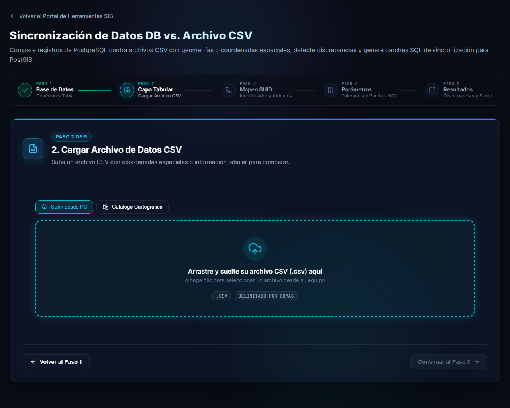
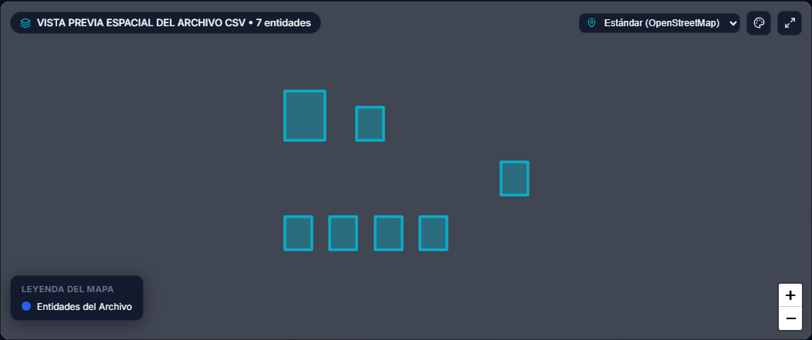
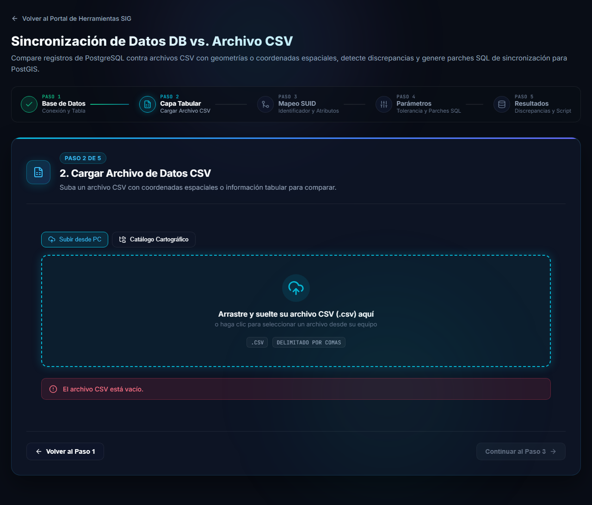

# Paso 2: preparar y cargar el archivo CSV

En el paso 2 se carga el archivo CSV con el que se va a comparar la tabla. El archivo se lee **en su navegador**: no se sube a ningún servidor.

## Cómo debe ser el archivo

- Un archivo `.csv` con una **primera fila de encabezados**.
- El separador se detecta solo (coma, punto y coma o tabulador). Las celdas con comillas se interpretan correctamente.
- Los acentos y la `ñ` deben estar codificados en UTF-8. Si el archivo trae una marca de orden de bytes (BOM), se descarta automáticamente.
- Debe incluir una columna que identifique cada registro y que exista también en la tabla (el **SUID**, por ejemplo `padron`). Los nombres de columna no tienen por qué coincidir: en el paso 3 se indica a qué columna de la base corresponde cada una.

### Geometrías en el CSV (opcional)

Si el archivo trae geometrías, la herramienta las reconoce y permite compararlas con las de la base. Hay dos formas:

| Forma | Cómo debe venir |
|---|---|
| **Columna de geometría** | Una columna llamada `geom`, `geometry`, `wkt`, `wkb_geometry`, `the_geom`, `geom_wkt` o `geom_wkb`, con el valor en texto **WKT** (por ejemplo `POINT(-56.12 -34.90)` o `POLYGON((...))`) o en **EWKB hexadecimal** (por ejemplo `0101000020E6100000...`). |
| **Columnas de coordenadas** | Dos columnas de latitud y longitud, con nombres como `lat`/`latitud`/`latitude` y `lng`/`lon`/`long`/`longitud`/`longitude` (también `x` e `y`). Cada fila se interpreta como un punto. |

> [!TIP]
> Las mayúsculas y minúsculas no importan en los nombres de las columnas de geometría y de coordenadas.

Si el archivo no trae ninguna de esas columnas, la herramienta compara solo los atributos.

## Cargar el archivo

Arrastre el archivo a la zona punteada, o haga clic en ella para elegirlo desde su equipo. En **Subir desde PC** se carga un archivo local. La pestaña **Catálogo Cartográfico** permite tomar el archivo desde un catálogo vigilado, cuando el módulo del Observador de Actualizaciones Cartográficas está disponible.

Cuando el archivo se lee correctamente aparece su resumen:

- El **nombre y el tamaño** del archivo, y la cantidad de **filas**.
- Las **columnas encontradas**, con sus encabezados.
- Si el archivo trae geometrías, una **vista previa espacial** con las entidades dibujadas en el mapa. Sirve para comprobar de un vistazo que las coordenadas están donde corresponde.
- El botón **Descartar archivo** quita el archivo para elegir otro.

> [!NOTE]
> En archivos muy grandes la vista previa del mapa muestra solo una parte de las entidades (hasta 25.000) para que la pantalla siga fluida, y lo avisa con un cartel. La comparación usa **todas** las filas del archivo, no solo las que se ven.

Con el archivo cargado se habilita **Continuar al Paso 3**.

## Si el archivo no se puede leer

Cuando el archivo tiene un problema, se muestra un mensaje en rojo debajo de la zona de carga y no se puede avanzar. Por ejemplo, un archivo sin contenido:

Corrija el archivo y vuelva a cargarlo. Más situaciones comunes en [Preguntas frecuentes](preguntas-frecuentes.md).

## Siguiente

Continúe con los [pasos 3 a 5: comparar y aplicar los parches](comparar.md).
