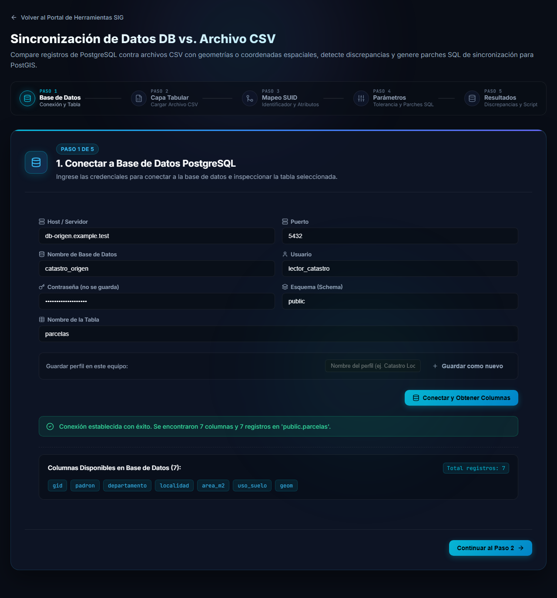

# Paso 1: conectar la base de datos

El primer paso conecta la **tabla de PostgreSQL** que se va a comparar contra el archivo. A diferencia de la herramienta DB vs. DB, aquí hay una sola conexión.

## Completar el formulario

| Campo | Qué ingresar |
|---|---|
| **Host / Servidor** | Nombre o dirección del servidor PostgreSQL. |
| **Puerto** | Por defecto `5432`. |
| **Nombre de Base de Datos** | La base que contiene la tabla. |
| **Usuario** | Usuario de PostgreSQL con permisos sobre la tabla. |
| **Contraseña (no se guarda)** | La contraseña del usuario. |
| **Esquema (Schema)** | Por defecto `public`. |
| **Nombre de la Tabla** | La tabla a comparar, sin el esquema. |

> [!NOTE]
> La contraseña **nunca se guarda**, ni siquiera en los perfiles guardados: hay que ingresarla cada vez que se abre la herramienta.

Presione **Conectar y Obtener Columnas**. Si todo está bien aparece un mensaje verde y se listan las columnas de la tabla:

> Conexión establecida con éxito. Se encontraron 7 columnas y 7 registros en 'public.parcelas'.

Recién entonces se habilita **Continuar al Paso 2**. Si falta el nombre de la base, el usuario o el nombre de la tabla, la herramienta lo avisa y no intenta conectarse.

## Perfiles guardados

Puede guardar sus conexiones como **perfiles** para no escribir los datos cada vez (sin contraseña, y solo **en este equipo**). La lista de perfiles incluye un buscador para encontrarlos rápido cuando son muchos. Todo el manejo de perfiles funciona igual que en las demás herramientas de sincronización: vea [Conectar las bases de datos](/wiki/db-db-sync/conexion).

> [!WARNING]
> Si vuelve a un paso anterior con **Volver**, es posible que deba presionar otra vez **Conectar y Obtener Columnas** antes de poder avanzar. Tenga a mano la contraseña.

## Siguiente

Continúe con el [paso 2: cargar el archivo CSV](archivo-csv.md).
