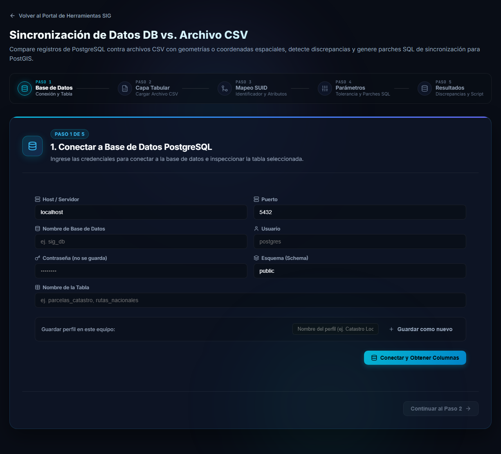

# Sincronización de Datos DB vs. CSV

Esta herramienta compara **una tabla de PostgreSQL/PostGIS** contra **un archivo CSV**. Detecta las diferencias de atributos y de geometría entre ambos y genera los **parches SQL** (`UPDATE` e `INSERT`) que dejarían la tabla igual que el archivo.

Se abre desde el portal, en la tarjeta **Sincronización de Datos DB vs. CSV**.

## ¿Cuándo usarla?

- Recibió un CSV actualizado (por ejemplo, un relevamiento o una exportación de otro sistema) y quiere saber qué cambió respecto de lo que hay en la base.
- Quiere aplicar a la base solo los cambios, sin recargar toda la tabla.
- El CSV trae geometrías (en texto WKT, en EWKB hexadecimal o como columnas de latitud/longitud) y quiere compararlas también.

> [!NOTE]
> La herramienta **no elimina datos**: los registros que existen solo en la base se informan, pero no se borran. Los parches solo actualizan e insertan, y solo se ejecutan cuando usted lo decide.

Si necesita comparar dos tablas de bases de datos en lugar de un archivo, use [Sincronización DB vs. DB](/wiki/db-db-sync). Si necesita **vaciar y recargar** una tabla completa, esa opción existe en esa herramienta (*Reemplazo completo*), no en esta.

## Qué necesita antes de empezar

- Los datos de conexión de la base: servidor, puerto, base de datos, usuario y contraseña, además del esquema y la tabla.
- El archivo CSV, con una fila de encabezados y una columna que identifique cada registro (el **SUID**).
- Si va a ejecutar los parches: un usuario con permiso de `UPDATE` e `INSERT` sobre la tabla.
- Una copia de seguridad de la tabla si los datos son importantes: los parches **no se pueden deshacer** desde la herramienta.

## Recorrido

| Paso | Nombre | Qué se hace |
|---|---|---|
| 1 | Base de Datos | Conectar a la tabla de PostgreSQL. |
| 2 | Capa Tabular | Cargar el archivo CSV y ver su vista previa. |
| 3 | Mapeo SUID | Elegir la columna identificadora, los atributos y la geometría a comparar. |
| 4 | Parámetros | Ajustar la tolerancia de codificación, la optimización de `UPDATE` y los valores por defecto. |
| 5 | Resultados | Revisar discrepancias, ver el mapa y aplicar los parches SQL. |

## Siguientes páginas

1. [Paso 1: conectar la base de datos](base-de-datos.md)
2. [Paso 2: preparar y cargar el archivo CSV](archivo-csv.md)
3. [Pasos 3 a 5: comparar y aplicar los parches](comparar.md)
4. [Preguntas frecuentes y problemas comunes](preguntas-frecuentes.md)
