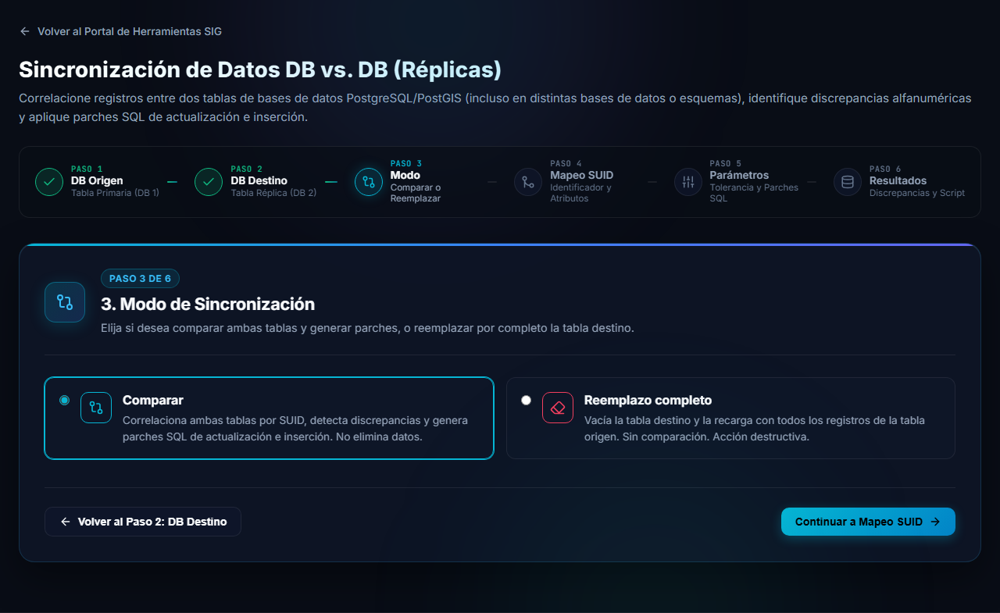
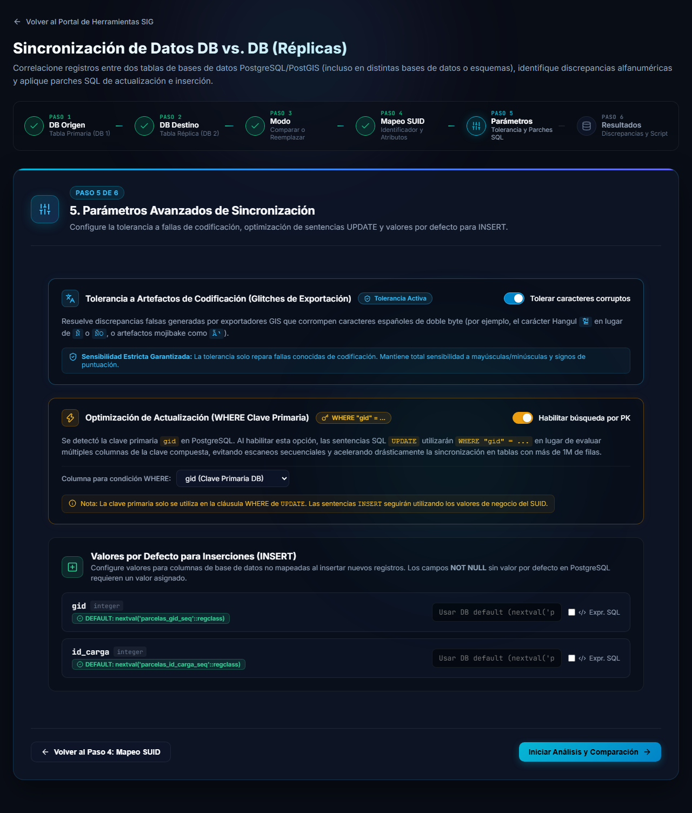
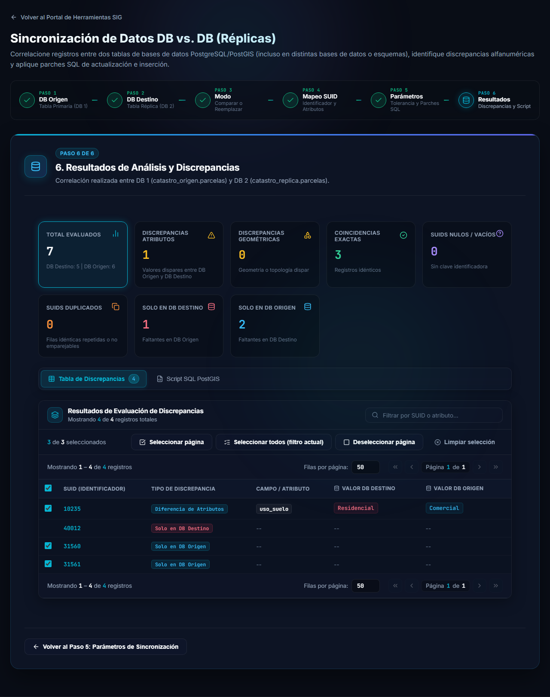
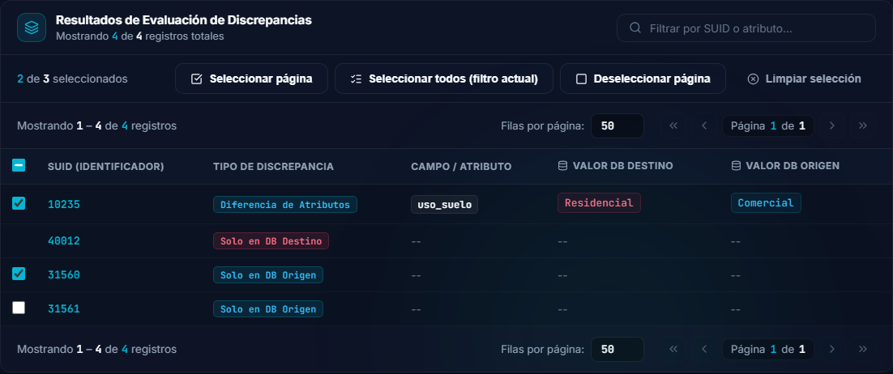
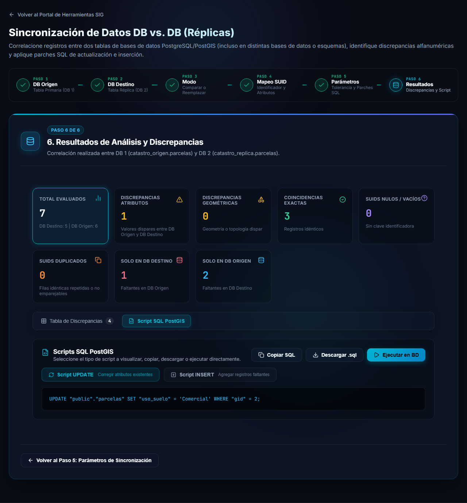
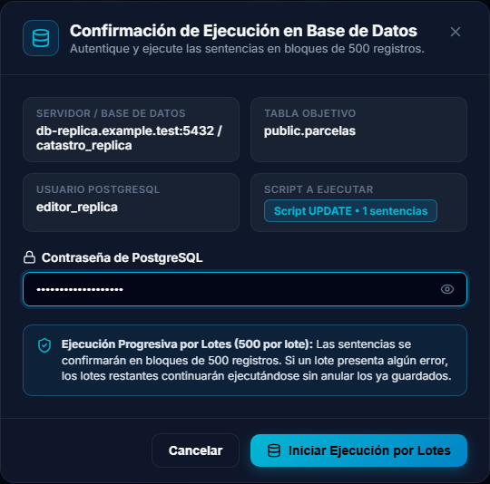

# Modo Comparar

El modo **Comparar** correlaciona la tabla origen con la tabla destino, le muestra las diferencias y genera los **parches SQL** que corrigen la tabla destino. **No elimina datos**, y no modifica nada hasta que usted decida ejecutar un parche.

## Paso 3: elegir el modo

Una vez conectadas las dos bases ([ver cómo](conexion.md)), el paso 3 pregunta qué desea hacer.

Deje seleccionado **Comparar** y presione **Continuar a Mapeo SUID**.

## Paso 4: identificar los registros (SUID)

Para saber qué registro de una tabla corresponde a cuál de la otra, la herramienta necesita un **identificador único compartido**, el **SUID**.

### 1. Identificador Único Compartido (SUID)

Marque la columna que identifica cada registro. Si un solo campo no alcanza, marque **varias columnas** y se usarán combinadas (por ejemplo `departamento` + `padron`): la etiqueta junto al título cambia de *Columna Única* a *Clave Compuesta (N columnas)*.

Cuando la columna también existe en la otra tabla, aparece un aviso verde, por ejemplo *Coincidencia en archivo fuente: padron*.

### 2. Atributos a comparar y mapeo 1-a-1

Marque las columnas cuyos valores quiere comparar y, a la derecha, elija qué columna de la tabla destino les corresponde. Las que tienen el mismo nombre se completan solas y muestran una etiqueta verde **Mapeado**. Las columnas sin marcar aparecen como **No comparado**.

- **Seleccionar todos** y **Limpiar selección** marcan o desmarcan todas de una vez.

Cuando esté listo, presione **Continuar a Parámetros de Sincronización**.

## Paso 5: parámetros

Los parámetros vienen con valores razonables. Revíselos solo si lo necesita:

- **Tolerancia a Artefactos de Codificación**, interruptor *Tolerar caracteres corruptos*. Evita falsas discrepancias cuando un exportador dañó caracteres del español (por ejemplo `Ñ` convertida en `Ño` o en símbolos extraños). Solo repara fallas de codificación conocidas: sigue distinguiendo mayúsculas, minúsculas y signos de puntuación.
- **Optimización de Actualización (WHERE Clave Primaria)**, interruptor *Habilitar búsqueda por PK*. Si la tabla tiene clave primaria, los `UPDATE` usan esa columna en el `WHERE` en lugar de varias columnas. Es mucho más rápido en tablas grandes (más de un millón de filas). Los `INSERT` siguen usando los valores de negocio del SUID.
- **Valores por Defecto para Inserciones (INSERT)**. Para las columnas de la tabla destino que no están mapeadas, puede indicar qué valor usar cuando se inserten registros nuevos. Si la columna es `NOT NULL` y no tiene un valor por defecto en PostgreSQL, es obligatorio indicar uno. Marque **Expr. SQL** si el valor es una expresión SQL en lugar de un texto fijo.

Presione **Iniciar Análisis y Comparación**. La herramienta lee ambas tablas y muestra el avance; en tablas grandes puede tardar.

## Paso 6: resultados

### Tarjetas de resumen

| Tarjeta | Significa |
|---|---|
| **Total evaluados** | Registros revisados, con el detalle de cuántos tiene cada base. |
| **Discrepancias atributos** | Registros presentes en ambas tablas con valores distintos. |
| **Discrepancias geométricas** | Registros con geometría o topología distinta. |
| **Coincidencias exactas** | Registros idénticos en ambas tablas. |
| **SUIDs nulos / vacíos** | Registros sin clave identificadora. |
| **SUIDs duplicados** | Filas idénticas repetidas o que no se pudieron emparejar. |
| **Solo en DB Destino** | Registros que están en el destino y faltan en el origen. |
| **Solo en DB Origen** | Registros que están en el origen y faltan en el destino. |

Haga clic en una tarjeta para filtrar la tabla por ese tipo.

### Tabla de discrepancias

Cada fila muestra el **SUID**, el **tipo de discrepancia**, el campo afectado y el **valor en cada base**. Use **Filtrar por SUID o atributo...** para buscar un registro concreto y los controles de página para recorrer la lista.

> [!NOTE]
> Si la tabla no tiene columna de geometría, la pestaña del mapa no aparece.

### Elegir qué registros corregir

Cada registro corregible tiene una **casilla** a la izquierda. **Solo los registros marcados** generan sentencias SQL: alimentan las vistas previas, los contadores y las acciones *Copiar SQL*, *Descargar .sql* y *Ejecutar en BD*.

- Pueden marcarse los registros con **Diferencia de Atributos**, **Diferencia Geométrica** y **Solo en DB Origen**. Los demás (por ejemplo *Solo en DB Destino*) no tienen casilla, porque la herramienta no genera sentencias para ellos.
- **Por defecto están todos marcados.** Desmarque los que no quiera corregir.
- La barra superior muestra el contador (*N de M seleccionados*) y los botones **Seleccionar página**, **Seleccionar todos (filtro actual)**, **Deseleccionar página** y **Limpiar selección**.
- La casilla de la cabecera marca o desmarca todos los registros de la página; queda en estado intermedio cuando solo algunos están marcados.
- La selección **se conserva** al cambiar de página, de filtro o de pestaña. Se reinicia solo cuando cambia la comparación.
- Con **ninguno** marcado no se genera ningún script y los botones de SQL quedan deshabilitados.
- Los registros emparejados que **no tienen clave primaria** aparecen con la casilla **deshabilitada** (*Sin clave primaria: no se puede actualizar de forma segura*): corregirlos con el SUID podría modificar varias filas por error.
- Las tarjetas de resumen siempre muestran el total de la comparación, sin importar qué registros estén marcados.

## Script SQL y parches

La pestaña **Script SQL PostGIS** reúne los parches **de los registros marcados** (por defecto, todos), que dejarían esos registros de la tabla destino iguales al origen.

- **Script UPDATE** corrige los atributos de los registros que existen en ambas tablas.
- **Script INSERT** agrega a la tabla destino los registros que solo están en el origen.
- Los registros que solo están en el destino **se informan, pero no se eliminan**.

Puede **Copiar SQL**, **Descargar .sql** para revisarlo o ejecutarlo por su cuenta, o presionar **Ejecutar en BD** para aplicarlo directamente.

### Ejecutar en la base de datos

La ventana muestra el servidor, la tabla, el usuario y el script que se va a ejecutar. Ingrese la **contraseña de PostgreSQL** del usuario y presione **Iniciar Ejecución por Lotes**.

- Las sentencias se confirman en **lotes de 500**.
- Si un lote falla, los lotes siguientes continúan ejecutándose y **no se anulan los que ya se guardaron**. Revise el resultado final para saber si hubo errores.

> [!WARNING]
> Los parches modifican la tabla destino y no se pueden deshacer desde la herramienta. Revise el script antes de ejecutarlo y tenga una copia de seguridad.

> [!NOTE]
> Si un SUID aparece repetido en alguna de las tablas, la herramienta empareja las filas una a una (primero por contenido idéntico y luego por cercanía geométrica). Una fila de un grupo repetido solo genera un `UPDATE` si una clave primaria con valor la identifica de forma única; de lo contrario se omite y se muestra una advertencia, para no modificar todo el grupo por error.
