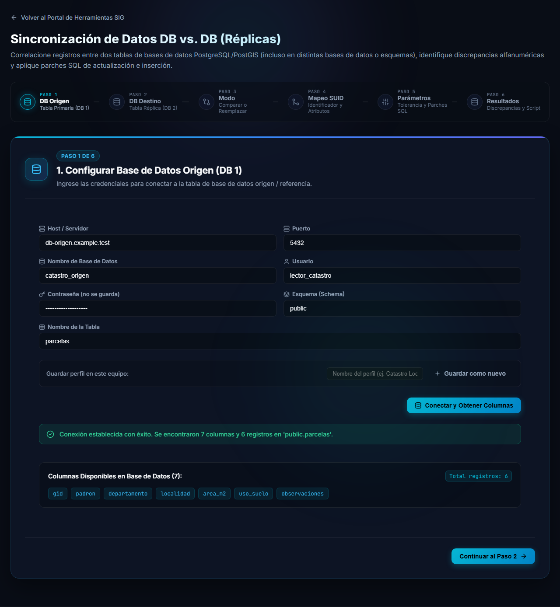
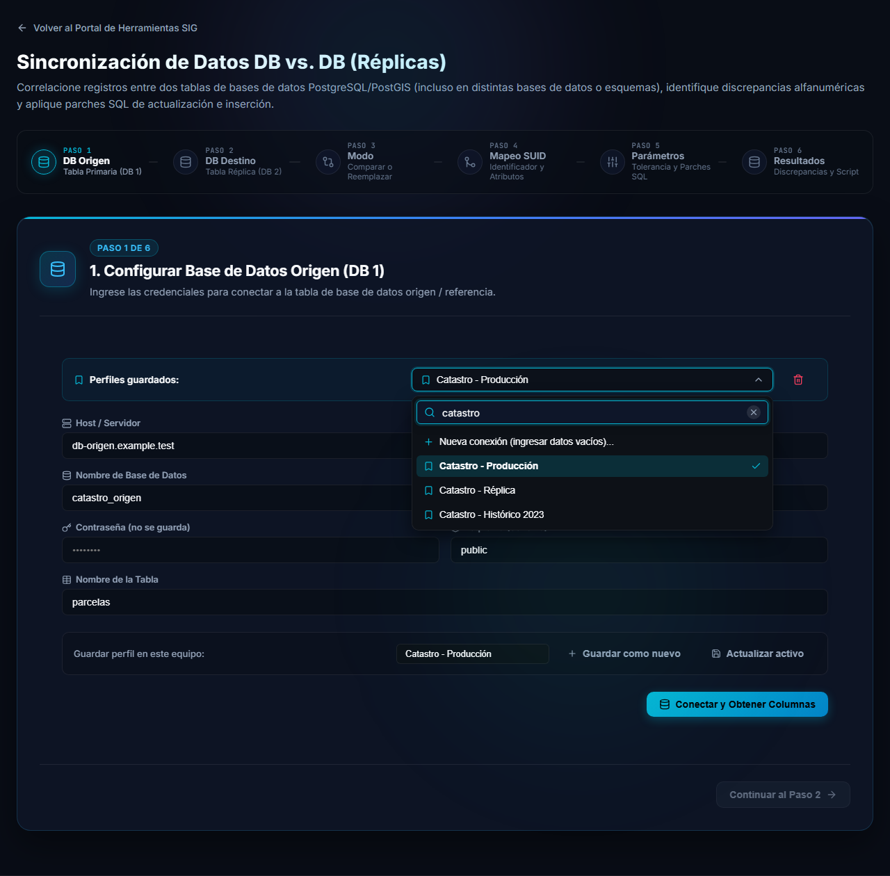
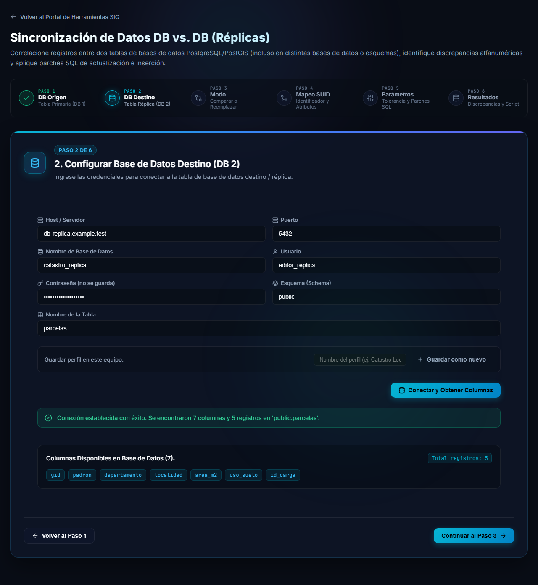

# Conectar las bases de datos

Los pasos **1 (DB Origen)** y **2 (DB Destino)** son iguales en los dos modos de trabajo y tienen el mismo formulario. Primero se conecta la tabla de referencia (origen) y luego la tabla que se quiere comparar o reemplazar (destino).

## Completar el formulario

| Campo | Qué ingresar |
|---|---|
| **Host / Servidor** | Nombre o dirección del servidor PostgreSQL. |
| **Puerto** | Por defecto `5432`. |
| **Nombre de Base de Datos** | La base que contiene la tabla. |
| **Usuario** | Usuario de PostgreSQL con permisos sobre la tabla. |
| **Contraseña (no se guarda)** | La contraseña del usuario. |
| **Esquema (Schema)** | Por defecto `public`. |
| **Nombre de la Tabla** | La tabla a utilizar, sin el esquema. |

> [!NOTE]
> La contraseña **nunca se guarda**, ni siquiera en los perfiles: hay que ingresarla cada vez que se abre la herramienta.

Cuando termine, presione **Conectar y Obtener Columnas**. Si todo está bien aparece un mensaje verde como este:

> Conexión establecida con éxito. Se encontraron 7 columnas y 6 registros en 'public.parcelas'.

Debajo se listan las **columnas disponibles** de la tabla y el total de registros. Recién entonces se habilita el botón **Continuar al Paso 2**.

Si falta el nombre de la base, el usuario o el nombre de la tabla, la herramienta lo avisa y no intenta conectarse.

## Perfiles guardados

Para no escribir los mismos datos todos los días, puede guardar sus conexiones como **perfiles**. Se guardan **en este equipo** (en el navegador que está usando), no en un servidor, y no incluyen la contraseña.

- **Guardar como nuevo**: escriba un nombre en *Nombre del perfil* y presione el botón.
- **Actualizar activo**: guarda los cambios sobre el perfil que está seleccionado.
- El ícono de papelera, junto a la lista, elimina el perfil seleccionado.

### Buscar un perfil

Cuando hay muchos perfiles, abra la lista **Perfiles guardados** y escriba en el campo de búsqueda: la lista se filtra a medida que escribe.

- La búsqueda **no distingue mayúsculas ni tildes**: `historico` encuentra *Catastro - Histórico 2023*.
- La opción **Nueva conexión (ingresar datos vacíos)...** siempre está disponible, aunque la búsqueda no encuentre nada. Sirve para empezar con un formulario vacío.
- Con el teclado: **↓** y **↑** recorren las opciones, **Enter** elige la resaltada y **Esc** cierra la lista. Mientras no mueva la selección ni escriba, Enter no hace nada, para evitar cambios accidentales.

> [!TIP]
> Al elegir un perfil se cargan todos los datos salvo la contraseña. No olvide ingresarla antes de conectar.

## Paso 2: base de datos destino

El paso 2 funciona igual: complete los datos de la tabla destino y presione **Conectar y Obtener Columnas**.

Cuando la conexión se establece se habilita **Continuar al Paso 3**, donde se elige el modo de trabajo.

> [!WARNING]
> Si vuelve a un paso anterior con **Volver**, es posible que deba presionar otra vez **Conectar y Obtener Columnas** antes de poder avanzar. Tenga a mano la contraseña.

## Siguiente

Con las dos conexiones listas, continúe con el [modo Comparar](comparar.md) o el [modo Reemplazo completo](reemplazo-completo.md).
