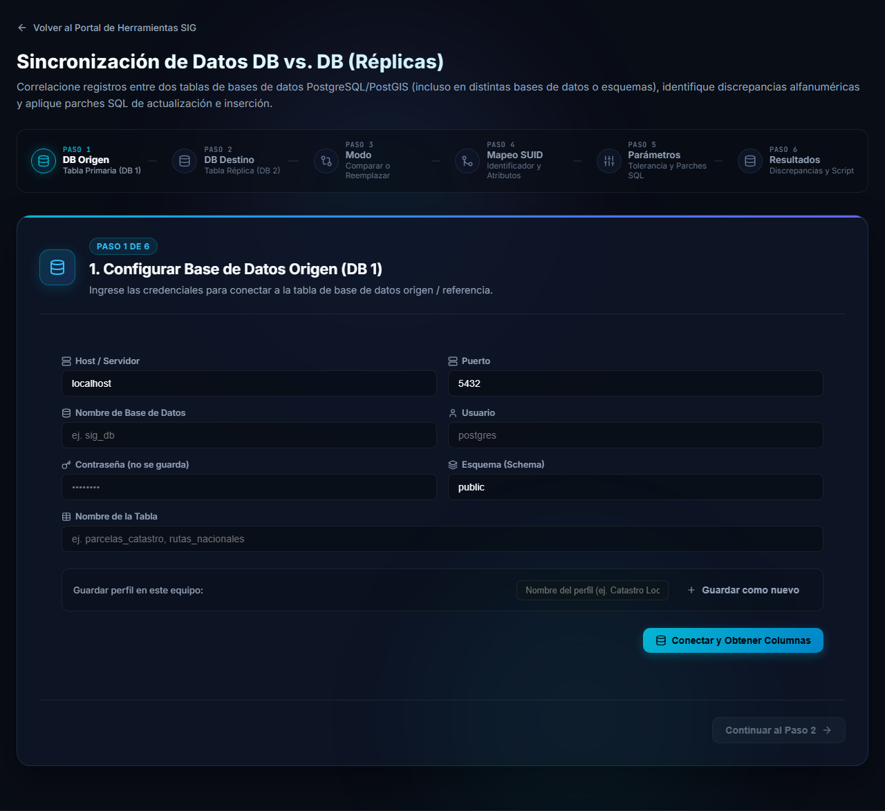

# Sincronización de Datos DB vs. DB (Réplicas)

Esta herramienta trabaja con **dos tablas de PostgreSQL/PostGIS**: una **origen** (DB 1, la de referencia) y una **destino** (DB 2, la réplica). Pueden estar en bases de datos, servidores o esquemas distintos. Los datos se leen directamente de ambas bases: no hace falta exportar archivos intermedios.

Se abre desde el portal, en la tarjeta **Sincronización de Datos DB vs. DB (Réplicas)**.

## ¿Para qué sirve?

Según lo que necesite, elija uno de los dos modos de trabajo:

| Modo | Qué hace | ¿Elimina datos? |
|---|---|---|
| **Comparar** | Correlaciona ambas tablas por un identificador (SUID), muestra las discrepancias y genera parches SQL de actualización (`UPDATE`) e inserción (`INSERT`) para la tabla destino. | No |
| **Reemplazo completo** | Vacía la tabla destino y la vuelve a cargar con todos los registros de la tabla origen. No compara nada. | **Sí**, todos los registros de la tabla destino |

> [!TIP]
> Si no está seguro, empiece por **Comparar**: solo le muestra diferencias y nunca modifica nada hasta que usted ejecute un parche.

## Qué necesita antes de empezar

- Los datos de conexión de las dos bases: servidor, puerto, base de datos, usuario y contraseña.
- Saber el esquema y el nombre de la tabla de cada lado.
- Un usuario con los permisos adecuados en la **tabla destino**: lectura y `UPDATE`/`INSERT` para el modo Comparar; `TRUNCATE` e `INSERT` para el Reemplazo completo.
- Una copia de seguridad de la tabla destino si los datos son importantes: las modificaciones **no se pueden deshacer** desde la herramienta.

## Recorrido general

La barra de pasos en la parte superior muestra dónde está. Los primeros tres pasos son comunes; luego el recorrido depende del modo elegido.

| Paso | Nombre | Se usa en |
|---|---|---|
| 1 | DB Origen | ambos modos |
| 2 | DB Destino | ambos modos |
| 3 | Modo (Comparar o Reemplazar) | ambos modos |
| 4 | Mapeo SUID | Comparar |
| 5 | Parámetros | Comparar |
| 6 | Resultados (discrepancias y script SQL) | Comparar |
| 4 | Mapeo de columnas | Reemplazo completo |
| 5 | Reemplazo completo | Reemplazo completo |

## Siguientes páginas

1. [Conectar las bases de datos](conexion.md): pasos 1 y 2, perfiles guardados y búsqueda.
2. [Modo Comparar](comparar.md): identificar registros, revisar discrepancias y aplicar parches.
3. [Modo Reemplazo completo](reemplazo-completo.md): vaciar y recargar la tabla destino con seguridad.
4. [Preguntas frecuentes y problemas comunes](preguntas-frecuentes.md).
