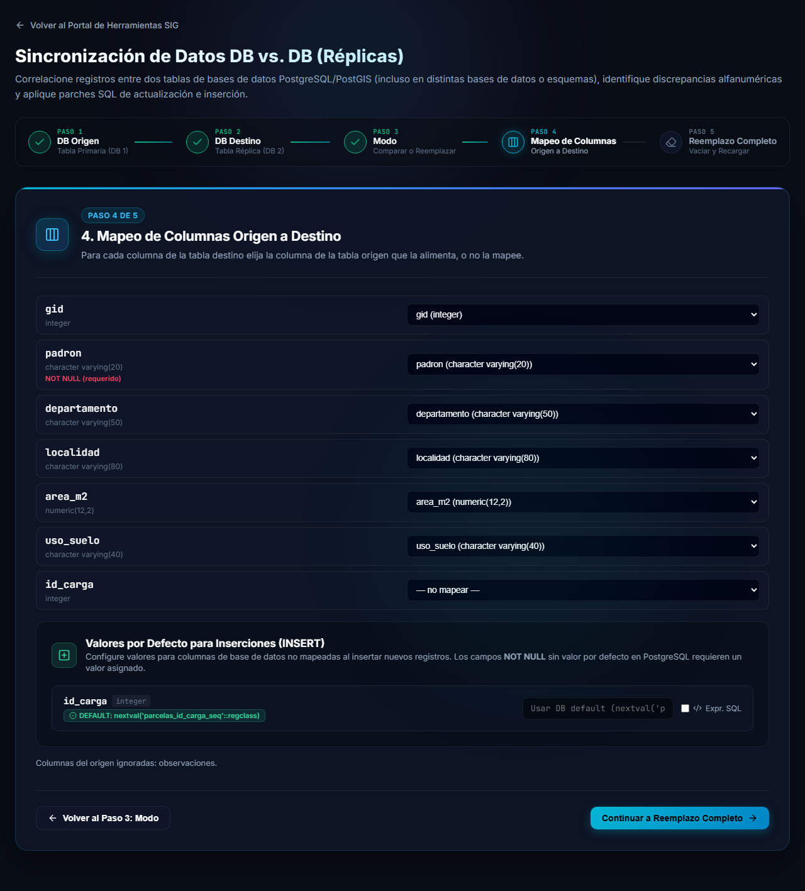
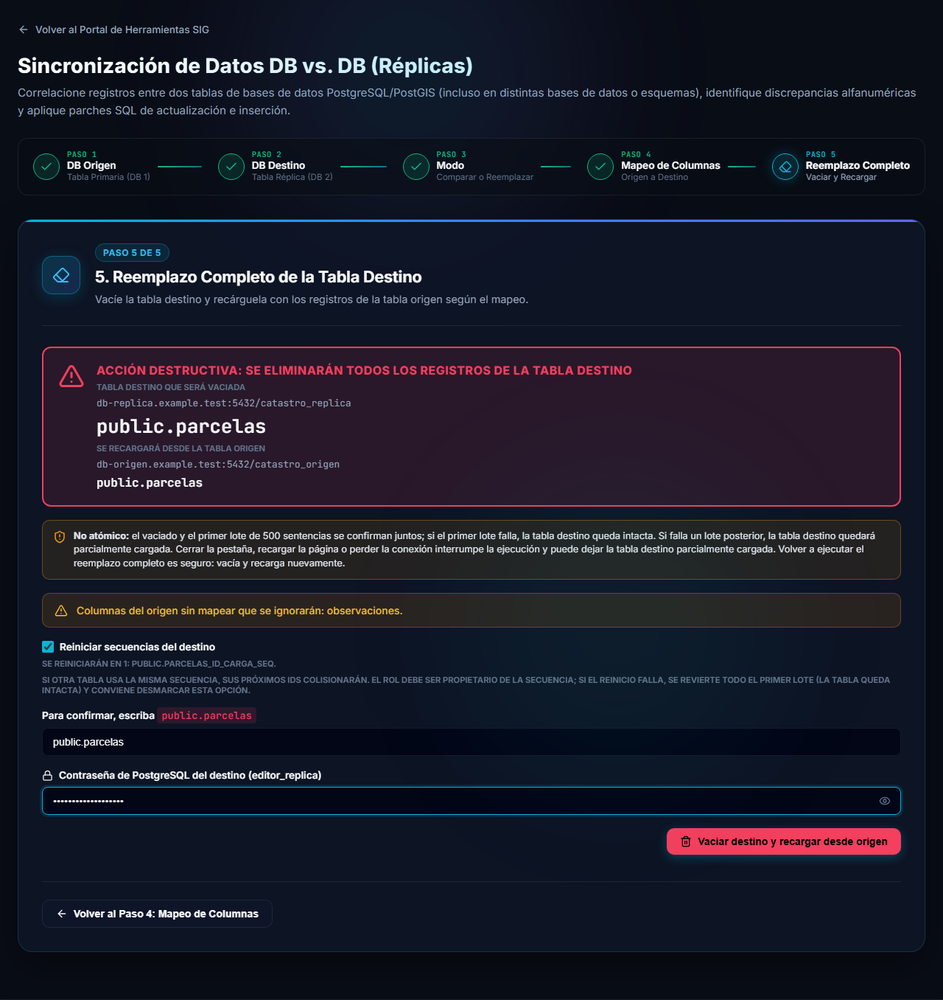
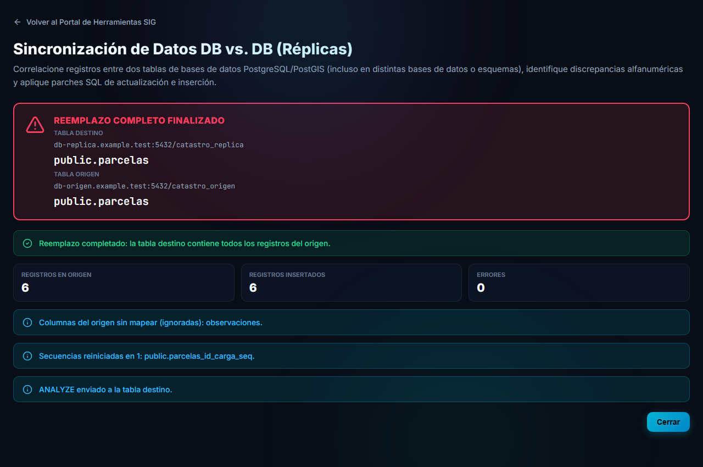

# Modo Reemplazo completo

El modo **Reemplazo completo** deja la tabla destino con **exactamente los mismos registros** que la tabla origen: primero **vacía** la tabla destino y luego la **vuelve a cargar** con todo lo que hay en el origen. No compara ni genera parches.

> [!WARNING]
> Es una acción **destructiva**: se eliminan **todos los registros** de la tabla destino. Tenga una copia de seguridad si esos datos importan. Si solo necesita corregir diferencias, use el [modo Comparar](comparar.md).

## Paso 3: elegir el modo

Después de conectar las dos bases ([ver cómo](conexion.md)), elija **Reemplazo completo**. La tarjeta lo marca como *Acción destructiva*.

El recorrido pasa a tener cinco pasos: el cuarto es el mapeo de columnas y el quinto es el reemplazo.

## Paso 4: mapeo de columnas

Las tablas origen y destino suelen tener columnas con nombres distintos (o incluso estar en esquemas distintos). Por eso, para **cada columna de la tabla destino** debe elegir de qué columna del origen sale su valor.

- Las columnas que tienen el mismo nombre en ambas tablas **vienen ya elegidas**.
- Elija **— no mapear —** para dejar una columna destino sin cargar: tomará su valor por defecto de PostgreSQL.
- Las columnas marcadas **NOT NULL (requerido)** deben estar mapeadas, o tener un valor definido en **Valores por Defecto para Inserciones (INSERT)** (puede ser una expresión SQL si marca **Expr. SQL**). Sin eso no se puede continuar.
- Las columnas del origen que no se usan se listan al pie: *Columnas del origen ignoradas*.
- Junto a cada columna se muestra su tipo. La herramienta **avisa** si detecta un conflicto evidente de tipos (por ejemplo, texto hacia un entero), pero **no convierte** los valores.

Presione **Continuar a Reemplazo Completo**.

## Paso 5: confirmar y ejecutar

La pantalla es roja a propósito.

### Revise bien

- El recuadro rojo muestra **qué tabla será vaciada** (servidor, base de datos y `esquema.tabla` del destino) y **desde qué tabla se recargará** (el origen). Verifique que no estén invertidas.
- El aviso **No atómico** explica el límite de seguridad (ver más abajo).
- Si hay columnas del origen sin mapear, se avisa que serán ignoradas.

### Reiniciar secuencias del destino

Si marca esta opción (viene marcada), los contadores automáticos (secuencias) de las columnas destino que **no** reciben datos del origen (ids generados por defecto) vuelven a empezar en 1 antes de la carga. Tenga en cuenta:

- Si otra tabla usa la **misma secuencia**, también se reinicia y sus próximos identificadores podrían chocar.
- Su usuario necesita permiso `UPDATE` sobre la secuencia (y `SELECT` sobre la tabla destino para calcular el id más alto). Si no lo tiene, el ajuste final falla y se informa como error.

### Ajuste final de secuencias

Al terminar, **siempre se ajusta** cada secuencia de la tabla destino, tanto si la columna se carga desde el origen como si no, y sea cual sea el resultado (éxito, fallo del primer lote o de un lote posterior). El próximo id queda por encima del **id más alto** que hay en la tabla y nunca por debajo de lo que la secuencia ya entregó. Así, un `INSERT` posterior sin id no choca con las filas existentes. El resumen muestra el próximo id de cada secuencia.

Limitación conocida: PostgreSQL no informa de un último valor para una secuencia que nunca se usó. Si esa secuencia tenía un inicio mayor que el id más alto + 1, puede quedar en el id más alto + 1. Es inofensivo para esta tabla y solo importa si otra tabla comparte la secuencia. El ajuste de secuencias tampoco es transaccional.

### Confirmar

1. En **Para confirmar, escriba** tipee exactamente el nombre `esquema.tabla` que se muestra (si el esquema está vacío se usa `public`). Distingue mayúsculas y minúsculas.
2. Ingrese la **contraseña de PostgreSQL del destino** (se muestra el usuario).
3. Presione **Vaciar destino y recargar desde origen**. Mientras no complete los dos datos, el botón permanece deshabilitado.

## Qué ocurre al ejecutar

El orden está pensado para proteger la tabla destino:

1. **Primero se leen todos los registros del origen.** Solo se piden las columnas mapeadas. Si la lectura falla, el origen está vacío o no hay columnas mapeadas, el proceso se detiene y **la tabla destino queda intacta**.
2. Se arman las sentencias `INSERT` en el navegador.
3. Se ejecuta el primer lote: la sentencia `DELETE` (borra todas las filas, sin `WHERE` ni `CASCADE`), los reinicios de secuencias y los primeros `INSERT`, todo en una sola transacción. Si ese lote falla, el borrado se revierte y la tabla destino recupera sus filas anteriores.

> [!NOTE]
> Las filas borradas quedan como espacio muerto hasta que los administradores ejecuten un vacuum.
4. Los lotes siguientes (de 500 sentencias cada uno) se ejecutan solo si el primero tuvo éxito.
5. Se ajustan las secuencias (también si algo falló, mientras se haya tocado la base de datos).
6. Si hubo cero errores en el reemplazo, se envía un `ANALYZE` a la tabla destino para actualizar las estadísticas del planificador.

> [!NOTE]
> Los valores se copian **tal cual** están en el origen (texto exacto de PostgreSQL), sin reinterpretar fechas ni números. Una cadena vacía hacia una columna numérica, de fecha, booleana o geométrica se guarda como `NULL`. Las geometrías se escriben con el tipo y el SRID de la columna destino. Si el origen tiene filas idénticas repetidas, **se copian todas**.

### Si algo sale mal

> [!WARNING]
> El reemplazo **no es atómico** más allá del primer lote. Si un lote posterior falla, o si cierra la pestaña, recarga la página o pierde la conexión, la tabla destino puede quedar **parcialmente cargada**. En ese caso **vuelva a ejecutar el Reemplazo completo**: es seguro, porque vacía y recarga otra vez desde cero.

- **No cierre ni recargue la pestaña** mientras se ejecuta.
- Si navega a otra página de la aplicación, el proceso **sigue corriendo**. Al volver a esta herramienta verá el avance en vivo, y luego el resumen o el error.
- No se puede iniciar un segundo reemplazo mientras hay uno en curso.
- No hay botón para cancelar ni límite de tiempo: si una solicitud nunca responde, el panel queda en *ejecutando* hasta recargar la página.

## Resultado

Al terminar aparece un resumen.

- **Registros en origen**, **Registros insertados** y **Errores**. Estos números deben coincidir: si los registros insertados son menos que los del origen, se muestra una advertencia en lugar de un éxito.
- Avisos informativos: columnas del origen ignoradas, una línea por secuencia ajustada con su próximo id y **ANALYZE enviado a la tabla destino**.
- Presione **Cerrar** para volver a la herramienta (solo se ofrece cuando el proceso terminó o falló).

> [!TIP]
> *ANALYZE enviado* significa que la orden se envió. En algunas versiones de PostgreSQL, si su usuario no es propietario de la tabla, el `ANALYZE` puede no tener efecto aunque no se muestre error.

Para dudas frecuentes y errores comunes, vea [Preguntas frecuentes y problemas comunes](preguntas-frecuentes.md).
