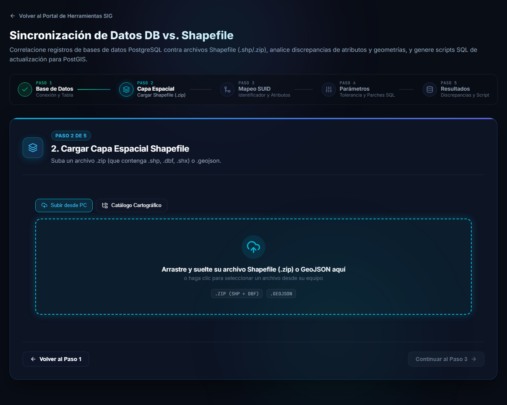
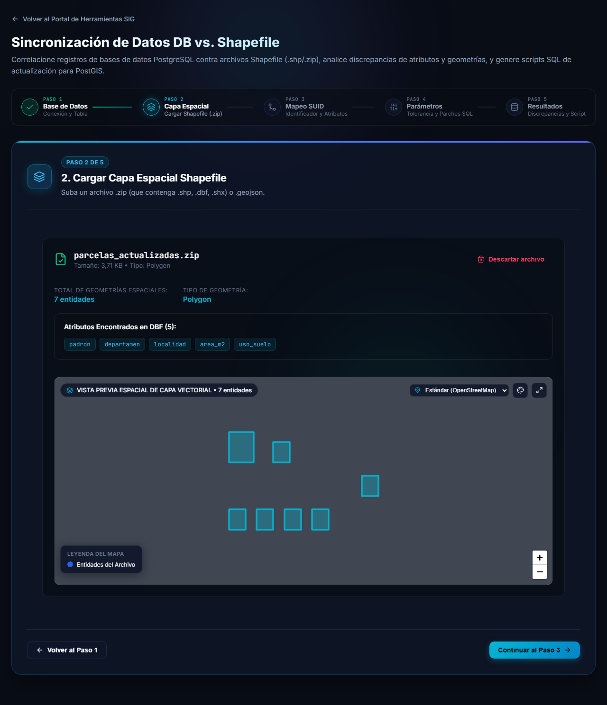
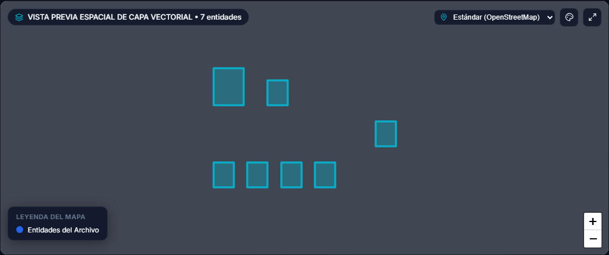
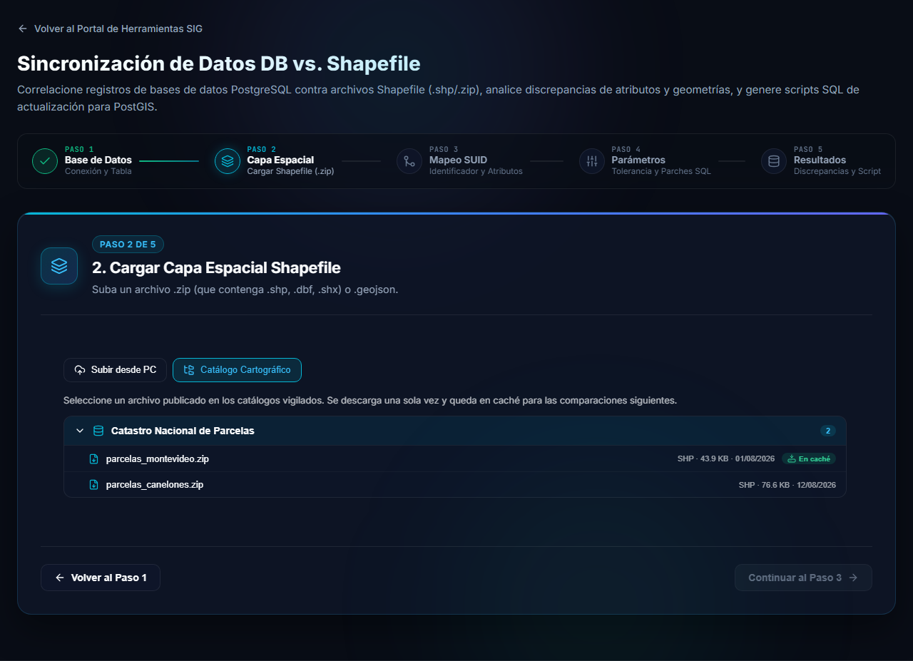
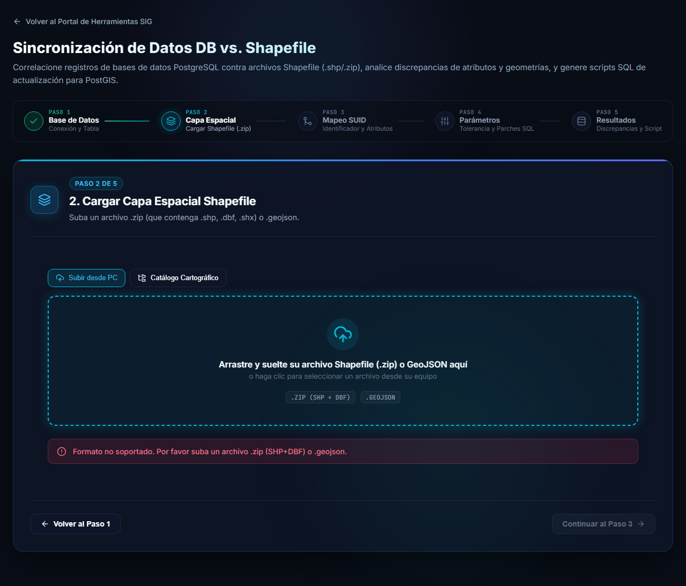

# Paso 2: preparar y cargar la capa

En el paso 2 se carga la capa espacial con la que se va a comparar la tabla. El archivo se lee **en su navegador**: no se sube a ningún servidor.

## Qué archivo puede cargar

| Formato | Cómo debe venir |
|---|---|
| **Shapefile** | Un archivo **`.zip`** que contenga el shapefile: `.shp` (geometrías), `.dbf` (atributos) y `.shx` (índice). Se recomienda incluir también el `.prj` (sistema de coordenadas) y el `.cpg` (codificación). |
| **GeoJSON** | Un archivo `.geojson` (o `.json`) con las entidades en formato GeoJSON. |

> [!WARNING]
> No se aceptan los archivos del shapefile sueltos (`.shp`, `.dbf`...): hay que comprimirlos juntos en un `.zip`. Cualquier otro formato se rechaza con el aviso *Formato no soportado. Por favor suba un archivo .zip (SHP+DBF) o .geojson.*

### Sistema de coordenadas

La capa puede venir en coordenadas proyectadas (por ejemplo UTM o Gauss-Krüger): la herramienta las convierte a coordenadas geográficas (WGS 84) para dibujarlas y compararlas. Esa conversión se hace a partir del archivo **`.prj`** que va dentro del `.zip`.

> [!WARNING]
> Si el `.zip` **no incluye el `.prj`**, la herramienta no puede convertir nada y usa las coordenadas tal como vienen, como si ya fueran grados WGS 84. Una capa proyectada sin `.prj` aparecerá en un lugar equivocado del mapa. Incluya siempre el `.prj`.

> [!NOTE]
> La pantalla no muestra qué sistema de coordenadas se detectó. Si las entidades aparecen en un lugar equivocado en la vista previa, revise que el `.prj` esté dentro del `.zip` y que corresponda a la capa.

### Nombres de atributos en el `.dbf`

El formato shapefile limita los nombres de las columnas a **10 caracteres**. Si en la base la columna se llama `departamento`, en el `.dbf` puede figurar como `departamen`. No es un error de la herramienta: en el paso 3 usted indica a qué columna de la base corresponde cada atributo de la capa.

## Cargar el archivo

Arrastre el archivo a la zona punteada, o haga clic en ella para elegirlo desde su equipo. En **Subir desde PC** se carga un archivo local.

Cuando el archivo se lee correctamente aparece su resumen:

- El **nombre y el tamaño** del archivo y el **tipo** de geometría (por ejemplo *Polygon*).
- El **total de geometrías espaciales** (cantidad de entidades) y el *tipo de geometría*.
- Los **atributos encontrados en el DBF**, con sus nombres.
- El botón **Descartar archivo** quita la capa para elegir otra.

### Vista previa espacial

Debajo del resumen, un mapa dibuja las entidades de la capa. Sirve para comprobar de un vistazo que están donde corresponde.

> [!NOTE]
> En capas muy grandes la vista previa muestra solo una parte de las entidades (hasta 25.000) para que la pantalla siga fluida, y lo avisa con un cartel. La comparación usa **todas** las entidades de la capa, no solo las que se ven.

Con la capa cargada se habilita **Continuar al Paso 3**.

## Elegir un archivo desde el catálogo

Además de subir un archivo desde su equipo, la pestaña **Catálogo Cartográfico** permite tomar el archivo de los **catálogos vigilados** por el Observador de Actualizaciones Cartográficas.

- Los archivos se agrupan por fuente. Haga clic en una fuente para ver sus archivos, con su formato, tamaño y fecha de publicación.
- Al elegir un archivo se **descarga una sola vez** y queda **en caché**: la etiqueta *En caché* indica que ya está descargado y que las próximas comparaciones no necesitan volver a bajarlo.
- En esta herramienta el catálogo muestra solo los archivos de tipo **SHP, ZIP, GeoJSON y JSON**. Los archivos CSV aparecen en el catálogo de la herramienta [DB vs. CSV](/wiki/db-csv-sync).

## Si la capa no se puede leer

Cuando el archivo tiene un problema, se muestra un mensaje en rojo debajo de la zona de carga y no se puede avanzar. Por ejemplo, un formato no soportado:

Corrija el archivo y vuelva a cargarlo. Más situaciones comunes en [Preguntas frecuentes](preguntas-frecuentes.md).

## Siguiente

Continúe con los [pasos 3 a 5: comparar y aplicar los parches](comparar.md).
