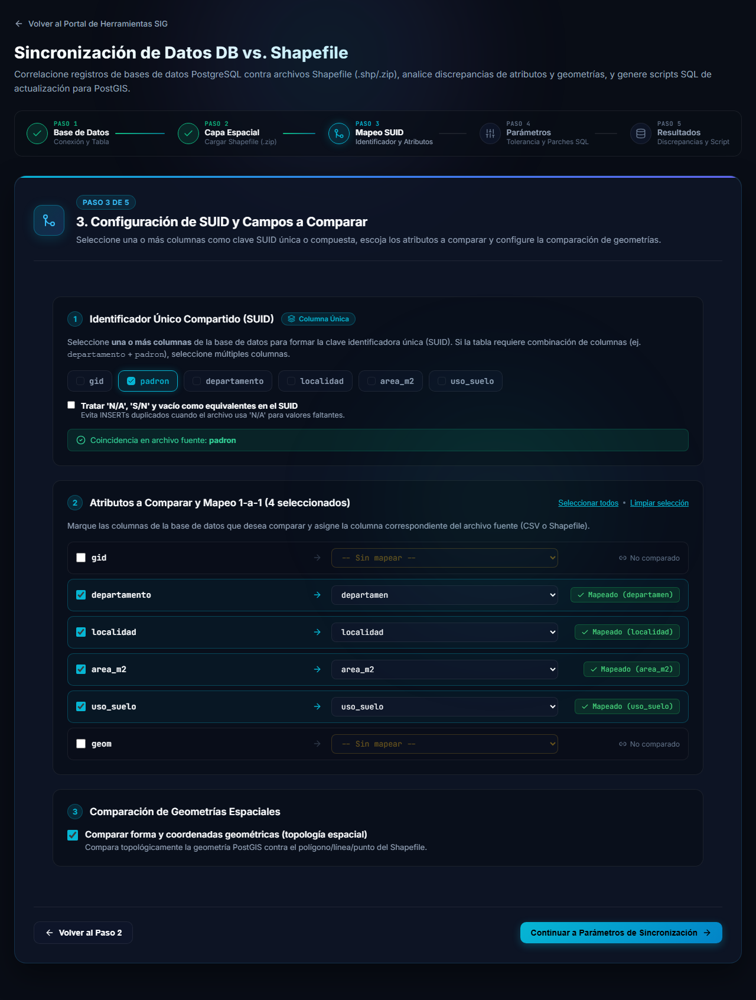
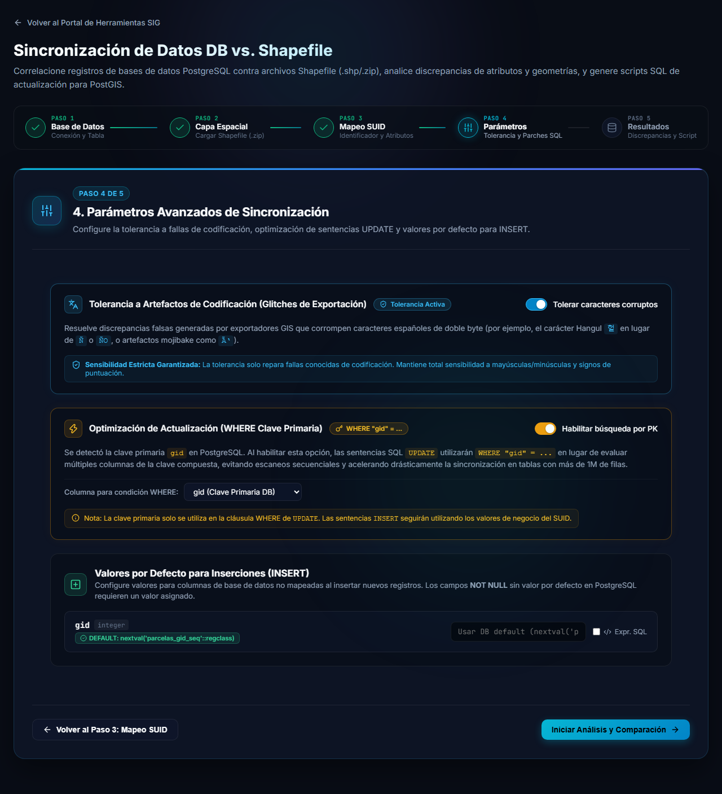
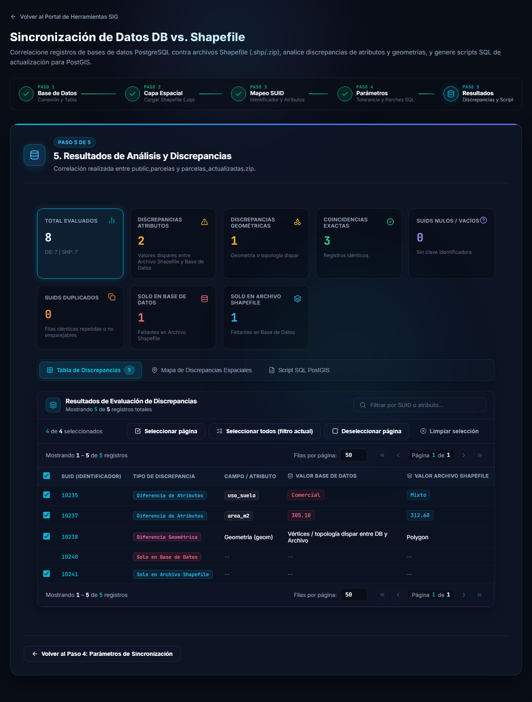
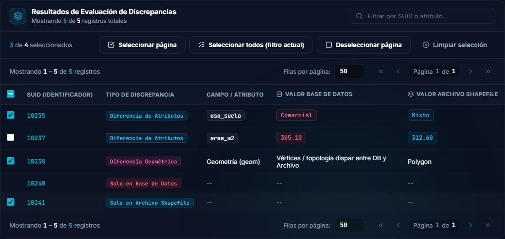
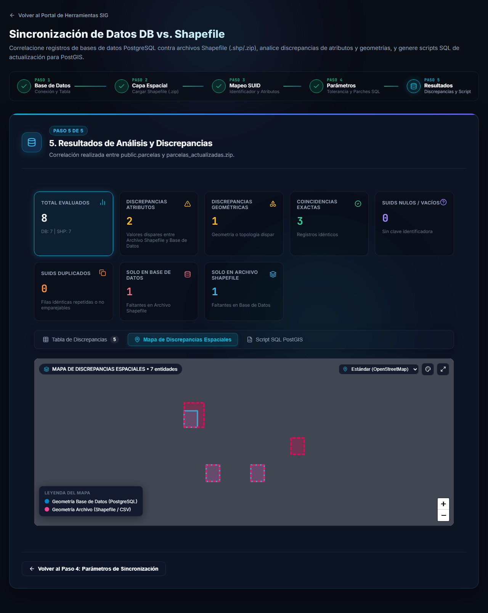
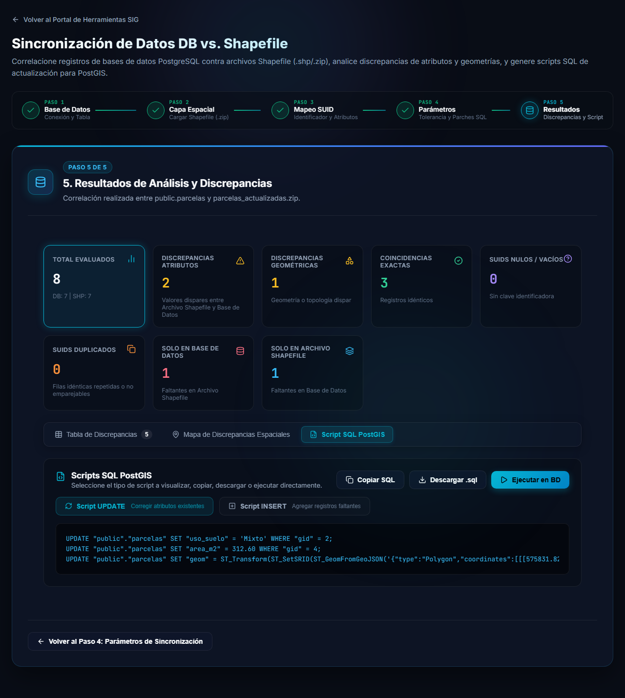
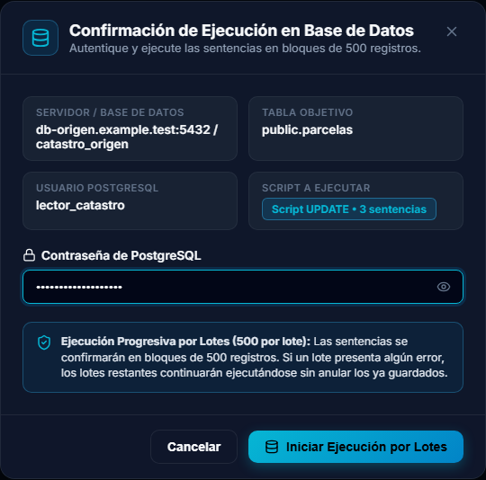

# Pasos 3 a 5: comparar y aplicar los parches

Con la base conectada y la capa cargada, estos tres pasos configuran la comparación, la ejecutan y permiten revisar y aplicar los resultados. **No se modifica nada en la base** hasta que usted ejecute un parche.

## Paso 3: SUID, atributos y geometría

### 1. Identificador Único Compartido (SUID)

Marque la columna de la base que identifica cada registro (por ejemplo `padron`). Si un solo campo no alcanza, marque **varias columnas** y se usarán combinadas: la etiqueta pasa de *Columna Única* a *Clave Compuesta (N columnas)*.

Cuando la columna también existe en la capa aparece un aviso verde: *Coincidencia en archivo fuente: padron*. Si en el `.dbf` el nombre figura cortado (por ejemplo `departamen`), lo elige usted en el paso siguiente.

### 2. Atributos a comparar y mapeo 1-a-1

Marque las columnas cuyos valores quiere comparar y, a la derecha, elija qué atributo del archivo les corresponde. Las que tienen el mismo nombre se completan solas y muestran una etiqueta **Mapeado**. Las columnas sin marcar aparecen como **No comparado**. **Seleccionar todos** y **Limpiar selección** marcan o desmarcan todas de una vez.

### 3. Comparación de geometrías espaciales

Marque **Comparar forma y coordenadas geométricas (topología espacial)** para detectar también las entidades cuya forma cambió, no solo las de atributos distintos.

Presione **Continuar a Parámetros de Sincronización**.

## Paso 4: parámetros

Los parámetros vienen con valores razonables. Revíselos solo si lo necesita:

- **Tolerancia a Artefactos de Codificación**, interruptor *Tolerar caracteres corruptos*. Evita falsas discrepancias cuando el `.dbf` se exportó con la codificación dañada y los caracteres del español aparecen alterados (por ejemplo, una `Ñ` convertida en `Ño`). Solo repara fallas conocidas: sigue distinguiendo mayúsculas, minúsculas y signos de puntuación.
- **Optimización de Actualización (WHERE Clave Primaria)**, interruptor *Habilitar búsqueda por PK*. Si la tabla tiene clave primaria, los `UPDATE` la usan en el `WHERE` en lugar de varias columnas, lo que acelera mucho la ejecución en tablas grandes. Los `INSERT` siguen usando los valores del SUID.
- **Valores por Defecto para Inserciones (INSERT)**. Para las columnas de la base que no vienen en la capa, indique qué valor usar al insertar registros nuevos. Si la columna es `NOT NULL` y no tiene valor por defecto en PostgreSQL, es obligatorio indicar uno. Marque **Expr. SQL** si el valor es una expresión SQL y no un texto fijo.

Presione **Iniciar Análisis y Comparación**. La comparación corre en segundo plano en su navegador y muestra el avance; en capas grandes puede tardar.

## Paso 5: resultados

### Tarjetas de resumen

| Tarjeta | Significa |
|---|---|
| **Total evaluados** | Registros revisados, con el detalle de cuántos tiene la base (DB) y cuántos la capa (SHP). |
| **Discrepancias atributos** | Registros presentes en ambos lados con valores distintos. |
| **Discrepancias geométricas** | Registros con geometría o topología distinta. |
| **Coincidencias exactas** | Registros idénticos en la base y en la capa. |
| **SUIDs nulos / vacíos** | Registros sin clave identificadora. |
| **SUIDs duplicados** | Filas idénticas repetidas o que no se pudieron emparejar. |
| **Solo en base de datos** | Registros que están en la base y faltan en la capa. |
| **Solo en archivo Shapefile** | Registros que están en la capa y faltan en la base. |

Haga clic en una tarjeta para filtrar la tabla por ese tipo.

### Tabla de discrepancias

Cada fila muestra el **SUID**, el **tipo de discrepancia**, el campo afectado y el **valor en la base** y **en el archivo Shapefile**. Para las diferencias de forma se indica *Diferencia Geométrica*. Use **Filtrar por SUID o atributo...** para buscar un registro concreto.

### Elegir qué registros corregir

Cada registro corregible tiene una **casilla** a la izquierda. **Solo los registros marcados** generan sentencias SQL: alimentan las vistas previas, los contadores y las acciones *Copiar SQL*, *Descargar .sql* y *Ejecutar en BD*.

- Pueden marcarse los registros con **Diferencia de Atributos**, **Diferencia Geométrica** y **Solo en Archivo Shapefile**. Los demás (por ejemplo *Solo en Base de Datos*) no tienen casilla, porque la herramienta no genera sentencias para ellos.
- **Por defecto están todos marcados.** Desmarque los que no quiera corregir.
- La barra superior muestra el contador (*N de M seleccionados*) y los botones **Seleccionar página**, **Seleccionar todos (filtro actual)**, **Deseleccionar página** y **Limpiar selección**.
- La casilla de la cabecera marca o desmarca todos los registros de la página; queda en estado intermedio cuando solo algunos están marcados.
- La selección **se conserva** al cambiar de página, de filtro o de pestaña. Se reinicia solo cuando cambia la comparación.
- Con **ninguno** marcado no se genera ningún script y los botones de SQL quedan deshabilitados.
- Los registros emparejados que **no tienen clave primaria** aparecen con la casilla **deshabilitada** (*Sin clave primaria: no se puede actualizar de forma segura*): corregirlos con el SUID podría modificar varias filas por error.
- Las tarjetas de resumen siempre muestran el total de la comparación, sin importar qué registros estén marcados.

### Mapa de discrepancias espaciales

La pestaña **Mapa de Discrepancias Espaciales** dibuja **todas** las entidades, sin recortes.

- Los contornos discontinuos de color marcan las entidades con discrepancia.
- Cuando la forma difiere se ven superpuestas la **geometría de la base de datos** y la **geometría de la capa**, para comparar a simple vista cuánto cambió.
- La leyenda indica qué color corresponde a cada origen. Puede cambiar el mapa base y ponerlo en pantalla completa con los botones de la esquina superior.

## Script SQL y parches

La pestaña **Script SQL PostGIS** reúne los parches **de los registros marcados**.

- **Script UPDATE** corrige los atributos y las geometrías de los registros que existen en ambos lados.
- **Script INSERT** agrega a la tabla los registros que solo están en la capa.
- Los registros que solo están en la base **se informan, pero no se eliminan**.
- Las geometrías de la capa se transforman al sistema de coordenadas de la columna de la base al escribirse (verá funciones `ST_Transform` en las sentencias).

La pantalla muestra una **vista previa** de hasta 25 sentencias de cada tipo; la cantidad total se informa aparte. Los botones **Copiar SQL** y **Descargar .sql** generan el script completo, y **Ejecutar en BD** lo aplica directamente.

### Ejecutar en la base de datos

La ventana muestra el servidor, la tabla, el usuario y el script que se va a ejecutar, con la cantidad de sentencias. Ingrese la **contraseña de PostgreSQL** y presione **Iniciar Ejecución por Lotes**.

- Las sentencias se confirman en **lotes de 500**.
- Si un lote falla, los siguientes continúan ejecutándose y **no se anulan los que ya se guardaron**. Revise el resultado final para saber si hubo errores.

> [!WARNING]
> Los parches modifican la tabla y no se pueden deshacer desde la herramienta. Revise el script antes de ejecutarlo y tenga una copia de seguridad.

> [!NOTE]
> Si un SUID aparece repetido en la base o en la capa, la herramienta empareja las filas una a una (primero por contenido idéntico y luego por cercanía geométrica). Una fila de un grupo repetido solo genera un `UPDATE` si una clave primaria con valor la identifica de forma única; de lo contrario se omite y se muestra una advertencia, para no modificar todo el grupo por error.
