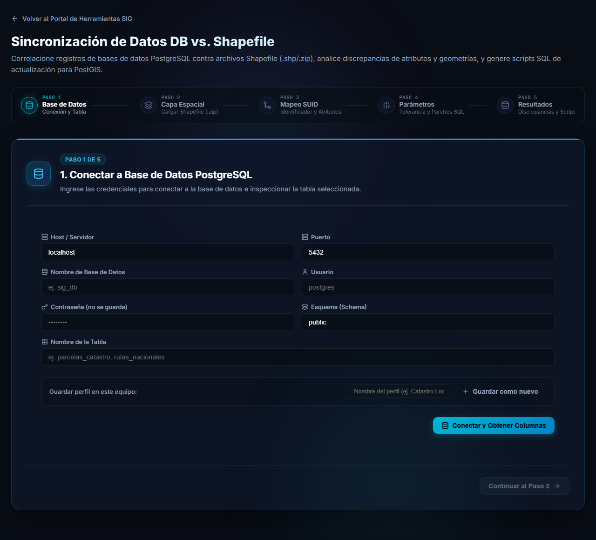

# Sincronización de Datos DB vs. Shapefile

Esta herramienta compara **una tabla de PostgreSQL/PostGIS** contra **una capa espacial** en formato Shapefile (o GeoJSON). Detecta las diferencias de atributos y de geometría entre ambas y genera los **parches SQL** (`UPDATE` e `INSERT`) que dejarían la tabla igual que la capa.

Se abre desde el portal, en la tarjeta **Sincronización de Datos DB vs. Shapefile**.

## ¿Cuándo usarla?

- Recibió una capa actualizada (por ejemplo un parcelario, una red vial o cualquier capa catastral) y quiere saber qué cambió respecto de lo que hay en la base.
- Quiere aplicar a la base solo los cambios, sin recargar toda la tabla.
- Necesita comparar **geometrías**, no solo atributos: la herramienta detecta las entidades cuya forma cambió.

La herramienta está pensada para capas muy grandes: la lectura del archivo y la comparación se hacen **en su navegador**, y soporta capas de más de un millón de polígonos.

> [!NOTE]
> La herramienta **no elimina datos**: los registros que existen solo en la base se informan, pero no se borran. Los parches solo actualizan e insertan, y solo se ejecutan cuando usted lo decide.

Si necesita comparar contra un archivo de texto, use [Sincronización DB vs. CSV](/wiki/db-csv-sync). Para comparar dos tablas entre sí, use [Sincronización DB vs. DB](/wiki/db-db-sync).

## Qué necesita antes de empezar

- Los datos de conexión de la base: servidor, puerto, base de datos, usuario y contraseña, además del esquema y la tabla.
- La capa, como un archivo `.zip` que contenga el shapefile (`.shp`, `.dbf`, `.shx` y, recomendado, `.prj`) o como un archivo GeoJSON.
- Una columna que identifique cada registro y exista en la tabla y en la capa (el **SUID**).
- Si va a ejecutar los parches: un usuario con permiso de `UPDATE` e `INSERT` sobre la tabla.
- Una copia de seguridad de la tabla si los datos son importantes: los parches **no se pueden deshacer** desde la herramienta.

## Recorrido

| Paso | Nombre | Qué se hace |
|---|---|---|
| 1 | Base de Datos | Conectar a la tabla de PostgreSQL. |
| 2 | Capa Espacial | Cargar el shapefile o GeoJSON y ver su vista previa. |
| 3 | Mapeo SUID | Elegir la columna identificadora, los atributos y la geometría a comparar. |
| 4 | Parámetros | Ajustar la tolerancia de codificación, la optimización de `UPDATE` y los valores por defecto. |
| 5 | Resultados | Revisar discrepancias, ver el mapa, elegir qué corregir y aplicar los parches SQL. |

## Siguientes páginas

1. [Paso 1: conectar la base de datos](base-de-datos.md)
2. [Paso 2: preparar y cargar la capa](archivo-shapefile.md)
3. [Pasos 3 a 5: comparar y aplicar los parches](comparar.md)
4. [Preguntas frecuentes y problemas comunes](preguntas-frecuentes.md)
